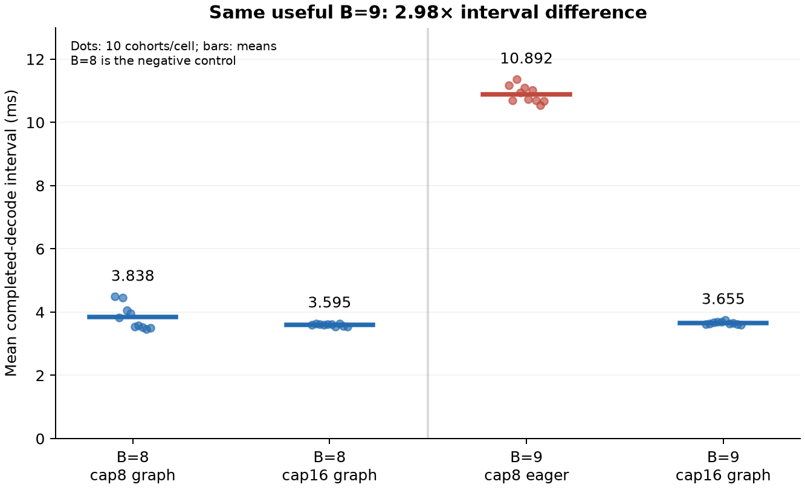
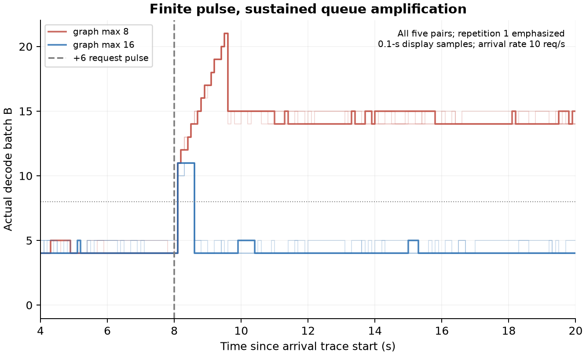
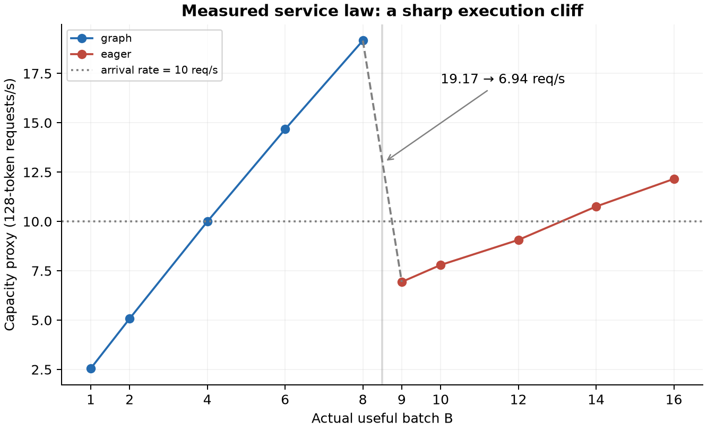
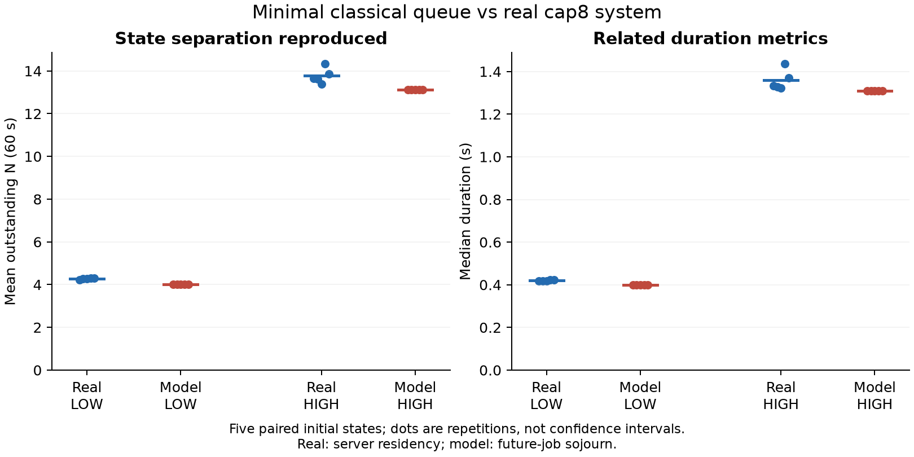

# LLM Serving Regime Study

**Execution cliffs, queue amplification, and a classical explanation in SGLang serving**

An empirical LLM systems study with causal controls and queueing-model falsification.
**Final screening decision: NO-GO FOR NEW OR GAP.** The systems effect is real;
a minimal classical state-dependent service queue already reproduces its principal behavior.

## What happens at a runtime execution boundary?

Modern LLM serving systems are often modeled using service rates that vary smoothly
with load or batch size. What happens when the runtime itself introduces a discontinuous
execution boundary?

In this tested installation—**SGLang 0.5.19, RTX 4070 12GB,
Qwen2.5-0.5B-Instruct, BF16, FlashInfer**—default decode CUDA-graph coverage ends at
useful batch **B=8**. B≤8 uses graph replay; B>8 falls back to eager execution.
This boundary is a software default, not the GPU's hardware capacity limit.

## Same batch, different execution path

Hold actual useful batch at **B=9**, change only configured graph coverage, and verify
the actual runtime path. The mean completed-decode interval changes from
**10.892 ms (eager) to 3.655 ms (graph): a 2.98× difference**.
This comparison keeps useful batch size fixed; graph replay pads B=9 into bucket 12.



The 2×2 design also includes B=8 under both graph ceilings as a negative control.
Its mean interval changes by 6.76%, with order-block drift reported explicitly.
Ten instrumented cohorts per cell and observer-off client proxies support a large
execution-path effect, without claiming kernel-only timing or zero instrumentation overhead.
[Design and every cohort](experiments/step2_service_cliff.md).

## A finite pulse amplifies queue state

At **10 requests/s**, baseline decode batch is about 5. Add six requests at t=8 s:

- **Graph max16:** B≈5 → 11–12 → 5; recovery takes about half a second.
- **Graph max8:** B≈5 → 21–22 → roughly 13–15; eager/high-batch operation persists.



All original pulse requests finish, but cap8 remains high for another approximately
10.5 seconds until arrivals stop. The residual state therefore outlasts the requests
that triggered it. [Five paired pulse trials](experiments/step3_pulse_response.md).

## Separation lasts through the 60-second test

LOW and post-pulse HIGH histories receive identical future schedules: 600 arrivals
over 60 seconds. At graph max8, LOW mean outstanding N is **4.23–4.32**, while HIGH
is **13.38–14.34** across five repetitions. LOW stays graph-covered; HIGH stays eager.
HIGH has 600 or 601 completions, so its net drift is approximately zero.
None of the five cap8 pairs returns to LOW within the tested horizon.

At max16, both histories pass the convergence criterion at the first evaluable
five-second window and every later window. This is **long-lived operating-state
separation over the tested horizon**, not a proof of hysteresis or bistability.
[Matched-arrival method and accounting](experiments/step4_long_horizon.md).

## A Classical Queue Already Explains It

A separate service calibration measures the following cap8 service law. Capacity
is useful token rate divided by 128 tokens/request; it is a fixed-length capacity
proxy, not measured end-to-end throughput. These calibration intervals are distinct
from the same-B causal measurements above.

| B | Regime | Capacity proxy (req/s) |
|---:|---|---:|
| 1 | graph | 2.551 |
| 2 | graph | 5.076 |
| 4 | graph | 9.996 |
| 6 | graph | 14.672 |
| 8 | graph | 19.166 |
| 9 | eager | 6.937 |
| 10 | eager | 7.795 |
| 12 | eager | 9.064 |
| 14 | eager | 10.758 |
| 16 | eager | 12.156 |



The B=8→9 boundary drops the capacity proxy from **19.17 to 6.94 requests/s**,
across the external arrival rate of 10 requests/s. B=4 is approximately 10, not
strictly greater than 10.

Now use a minimal processor-sharing queue:

$$B=N,\qquad \frac{dw_i}{dt}=-\frac{\mu_{\mathrm{tok}}(N)}{N}.$$

Only the measured aggregate service law and remaining request work enter the model.
There is no history variable, hidden operating mode, learned parameter or complex scheduler.
The service rate is linearly interpolated between measured points; new requests require
128 tokens. Initial work is reconstructed from the observed request lifecycles.

| Metric | Real LOW | Model LOW | Real HIGH | Model HIGH |
|---|---:|---:|---:|---:|
| Mean N | 4.23–4.32 | 4.00 | 13.38–14.34 | 13.11–13.13 |
| Median duration (s) | 0.417–0.424 | 0.400 | 1.323–1.436 | 1.311 |



Real duration is server residency; model duration is future-job sojourn. The definitions
are related but not identical. The model underpredicts mean N by 5.3–7.2% for LOW and
2.0–8.5% for HIGH, yet reproduces the principal separation without corrective fitting.
[Classical-model test and sensitivity cases](experiments/step5_classical_model.md).

## Remove the cliff

In the model, extend the B=8 per-job graph speed above B=8, holding arrivals,
workload and HIGH initial work fixed. HIGH returns to **B≤8 in 0.23–0.26 seconds**.
That is qualitatively consistent with the real max16 control. It is an explicitly
extrapolated counterfactual, not a calibrated max16 performance prediction.

## What this study establishes

CUDA-graph coverage can create a sharp service-rate discontinuity that amplifies
queue state and sustains a high-batch operating regime in the tested serving system.
But the evidence does not require a new queueing abstraction: a minimal classical
state-dependent queue reproduces the principal behavior.

The contribution is empirical mechanism identification and falsification. **An
LLM-specific mechanism does not, by itself, establish a new OR phenomenon.** No new
scheduler, formulation, algorithm, stability theorem, hysteresis proof or bistability
proof is claimed. [Limitations](docs/limitations.md) include the single GPU/model/backend,
finite horizon, simplified model and unvalidated extrapolations.

## Reproduce the offline study

Requires Python 3.10+; validated with Python 3.12.14, NumPy 2.3.5 and Matplotlib 3.11.2.
From the repository root:

```bash
python -m pip install -r requirements.txt
python src/analyze_service_curve.py
python src/simulate_state_dependent_queue.py
python src/validate.py
python src/make_figures.py
```

These commands rebuild the service curve, run 60 deterministic model scenarios,
check frozen results and flow conservation, and recreate the four figures. No GPU,
model download or API access is required. GPU measurement reproduction is documented
but is **not** supplied as a tested runnable harness.

- [Experiment evidence](experiments/README.md): questions, methods, results and verdicts.
- [Methodology](docs/methodology.md): environment, timing, path verification and accounting.
- [Data provenance](docs/data_provenance.md): inputs, units, derived outputs and sanitization.
- [Limitations](docs/limitations.md): what the evidence cannot establish.

Code and released study artifacts are provided under the [MIT License](LICENSE).

## GPU mechanism pipeline extension

Phase 2B/2C adds a fixed-cohort runner with verified graph/eager policies and bounded
Nsight Systems capture. [Runner instructions](profiling/README.md) and the
[fresh-environment validation report](outputs/gpu-mechanism-study/REPORT.md) document
the four supported arms, two output lengths, trace exports, observed overhead and
trace completeness limitations. This extension does not change the historical
tables or claim GPU-level causal attribution.

Phase 2D completes the [controlled trace campaign](outputs/gpu-mechanism-study/phase2d/REPORT.md):
three independent primary traces per arm, separate unprofiled repetitions, and a
smaller output256 confirmation. The [protocol](profiling/phase2d_protocol.md)
defines the steady decode region, observed-count limitations and reproduction.
