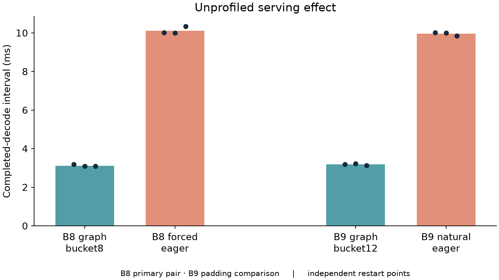
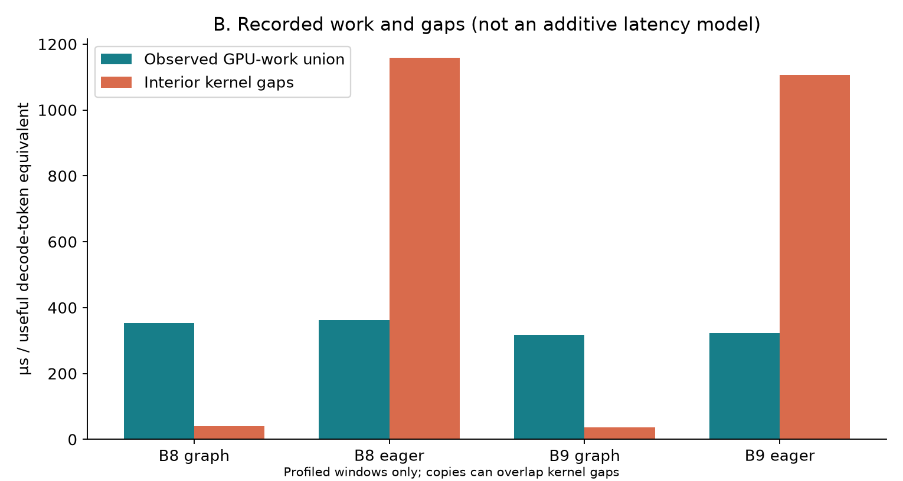
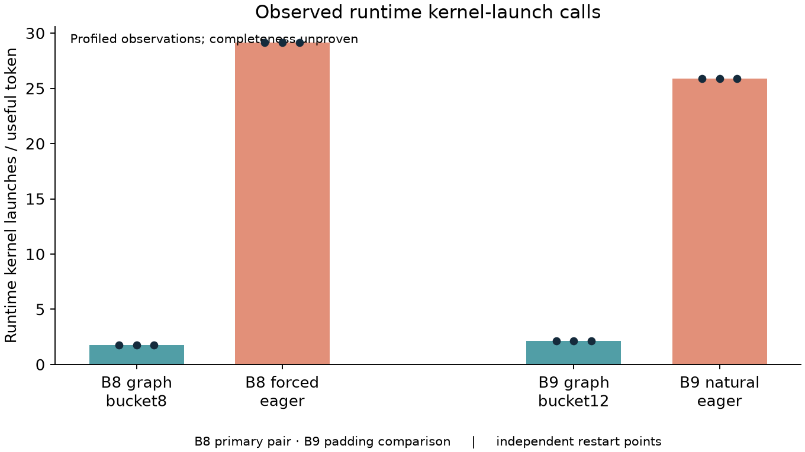
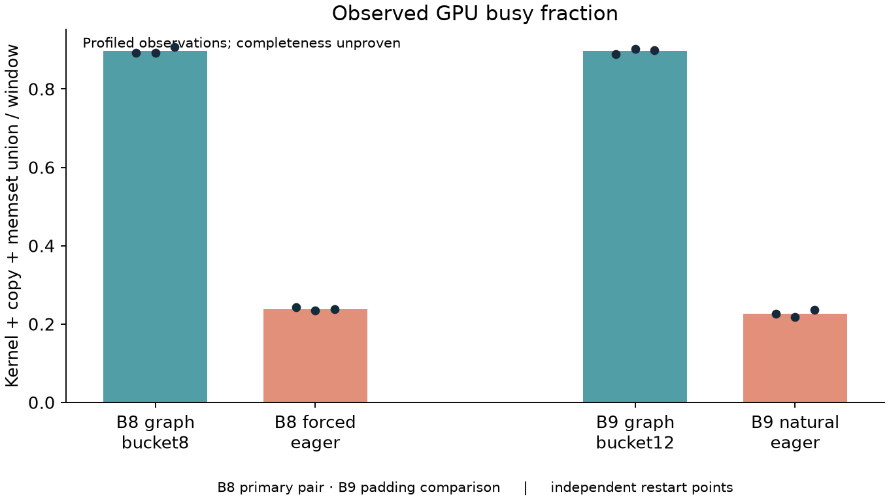
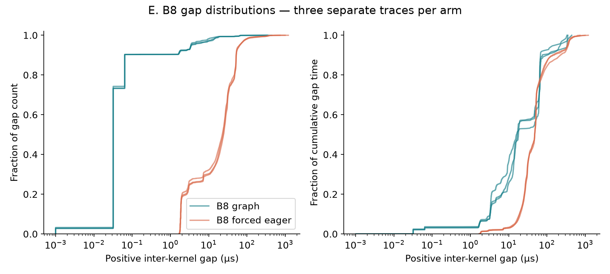
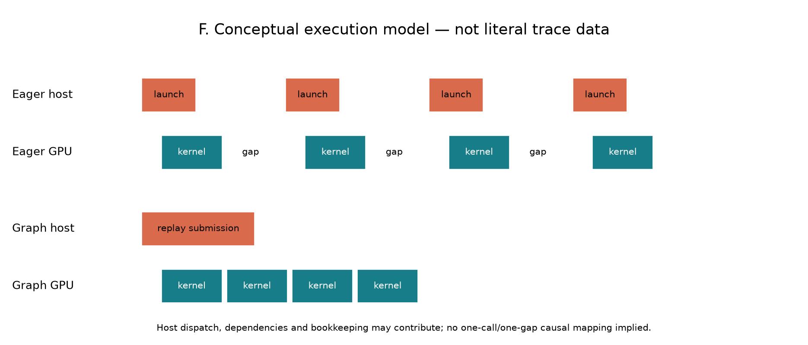

# Curated research figures

The six Phase 2E figures form the main narrative. No new trace screenshots or data
are introduced. PNG and SVG versions are retained beside each other. Historical
service-curve/pulse/queue-model figures and Phase 2D kernel-family figures remain
available as supporting material; they are not repeated in the main narrative.

## A. Unprofiled serving effect

**Figure A.** Mean completed-decode interval for B8 graph/eager and B9 graph/eager
with input128/output128. Each point is one independent unprofiled restart mean
over three measured cohorts; bars summarize three restarts. Three warmups per
start are excluded. B8 is the same-useful-batch primary control; B9 graph pads to
bucket12. These measurements, rather than profiled latency, estimate serving effects.

## B. Observed GPU work and gaps

**Figure B.** Means across three traces per arm of observed GPU-work union and
positive interior inter-kernel gaps, normalized by 70×useful B token equivalents.
Work includes kernels, copies and memsets across streams without double-counting
overlap. Kernel gaps can contain copies, so the two bars are not additive latency
components. Eager work remains close to graph while gaps are much larger.

## C. Individual runtime launches

**Figure C.** Observed individual runtime kernel-launch calls per useful decode-token
equivalent in the marked submission window, with three independent traces per arm.
Driver-layer calls are kept separate; graph-replay submissions are not counted as
individual kernel launches. Graph arms have 70 observed replay calls per window;
eager arms have zero. Counts are observed, not certified exhaustive totals.

## D. Observed GPU busy fraction

**Figure D.** Union of recorded kernel/copy/memset intervals divided by the full
marked steady window. Points represent three traces per arm. The quantity describes
recorded activity density, not SM occupancy or unbiased unprofiled utilization.
Missing records can reduce measured busy fraction; Nsight completeness warnings remain.

## E. B8 gap distributions

**Figure E.** B8 graph/eager positive kernel-union gaps, one curve per trace. Left:
cumulative fraction of gap count. Right: cumulative fraction of total gap duration.
The horizontal axis is logarithmic in microseconds. Eager gaps are broadly larger;
graph also has a tail, but much less absolute gap time. Tiny graph gaps should not
be interpreted beyond timestamp/profiler resolution. No gap is automatically labeled
CPU launch overhead.

## F. Conceptual execution model

**Figure F. Conceptual illustration — not literal trace scale.** The same four
illustrative kernels are separated by larger gaps under repeated eager submissions
and denser under graph replay. Host dispatch, bookkeeping, dependencies and driver
behavior may contribute. Rectangle positions do not establish one-call/one-gap
causality or represent measured durations.
