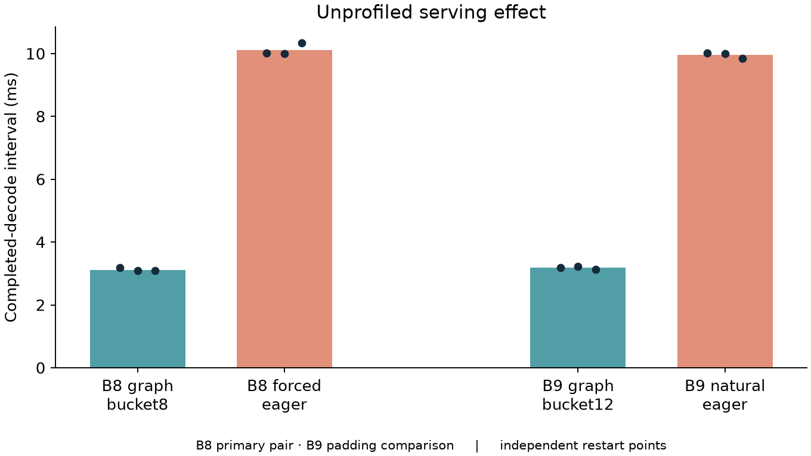
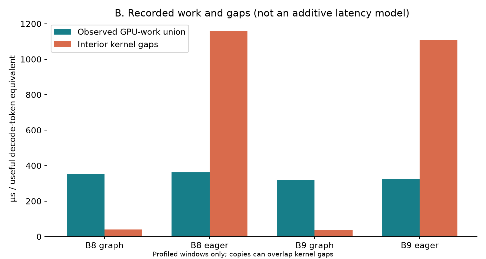
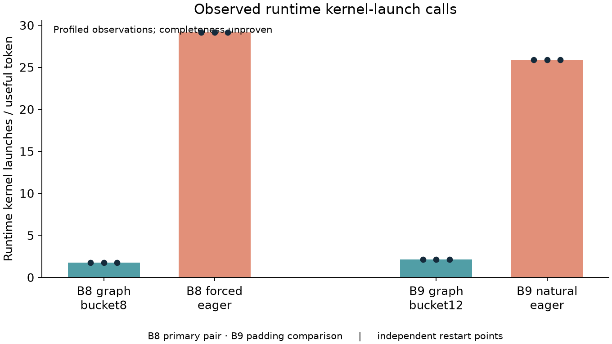
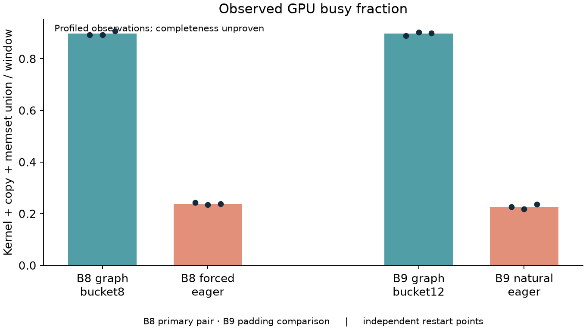
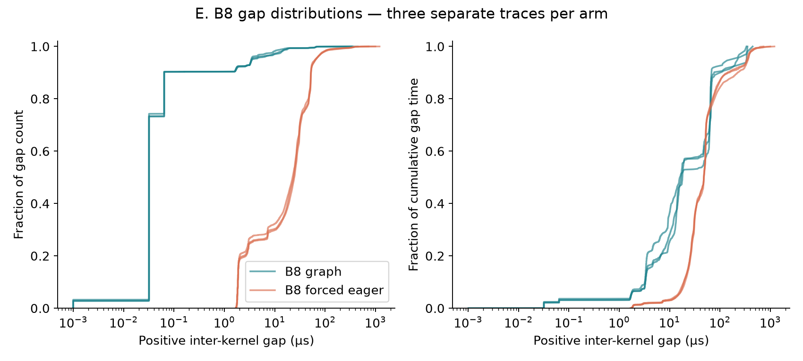
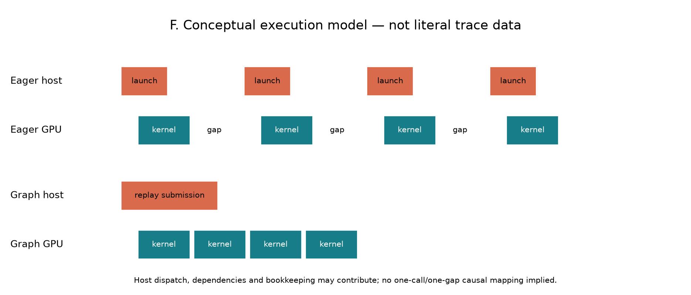

# SGLang Decode Execution Regimes

**Same-batch serving effects, GPU mechanism evidence, and regime-aware service modeling**

## 1. Motivation

Batch size is a natural input to an inference service model, but it does not fully
specify how a runtime executes that batch. CUDA Graph coverage, fallback policy and
replay buckets can change execution structure. This study asks whether such a
regime change can produce a large serving effect even when useful work is held fixed.

## 2. Initial service-rate observation

The historical study observed an execution boundary around B8→B9 in the tested
SGLang installation. Raising graph coverage at B9 changed completed-decode cadence
from 10.892 to 3.655 ms. Finite-pulse and matched-arrival experiments subsequently
showed long-lived queue-state separation over a 60-second observation horizon.
These were finite observations, not a proof of bistability or a stability theorem.

A classical state-dependent service queue reproduced the principal qualitative
behavior. Its screening conclusion remains **no-go for a new OR gap**: the systems
phenomenon did not establish a novel queueing mechanism or require a new scheduler.
Historical measurements remain separate from the fresh-environment results below;
their values are not pooled. [Historical experiments](../../experiments/README.md).

## 3. Research question

At fixed useful batch, how much does decode execution regime change serving rate,
and which observed GPU/runtime structures best explain that difference? The primary
test uses B8 without graph padding. The goal is to discriminate substantial extra
GPU computation, a different computational path, synchronization, kernel efficiency,
and repeated host/runtime orchestration as competing explanations.

## 4. Experimental system

The system is a single RTX 4070 12GB, SGLang 0.5.19, and
Qwen2.5-0.5B-Instruct at revision `7ae557604adf67be50417f59c2c2f167def9a775`, using
BF16 and FlashInfer. Driver 581.08, PyTorch 2.13.0+cu130 and Nsight Systems
2026.1.3 are recorded. PyTorch's CUDA build is 13.0; the installed nvcc toolkit is
13.3. Execution uses overlap, disabled radix cache, seed 42 and greedy generation.

Primary requests have 128 synthetic input tokens and forced output128. A smaller
output256 set checks persistence of the pattern. Model revision, useful batch,
execution mode, replay bucket and output length are verified rather than assumed.
The [reproduction guide](../../docs/REPRODUCIBILITY.md) records the full workflow.

## 5. Same-B controlled experiment

The primary pair is B8 graph bucket8 versus B8 forced decode eager, both with cap8.
This holds useful batch and workload fixed without introducing graph padding.
The practical B9 pair compares natural eager at cap8 against graph at cap16,
verified bucket12. It changes graph coverage and padding together and is secondary.

Each primary arm has three independent unprofiled server starts, three measured
cohorts per start, and three separate independent trace captures. Every start has
three excluded warmups. Block order varies and GPU runs are sequential. Output256
adds two traces and one unprofiled start per B8 arm. All 16 traces pass structural
acceptance; no invalid attempt was silently replaced. Structural acceptance does
not certify exhaustive capture.

## 6. Serving results

**Unprofiled measurements estimate the serving effect.** Values below are means ±
sample SD across three independent restart means, not confidence intervals over
individual token events.

| Arm | Decode interval ms | Useful decode tokens/s | Cohort E2E s |
|---|---:|---:|---:|
| B8 graph | 3.117 ± 0.053 | 2,566.9 | 0.420 ± 0.007 |
| B8 eager | 10.114 ± 0.187 | 791.2 | 1.323 ± 0.029 |
| B9 graph bucket12 | 3.180 ± 0.049 | 2,830.8 | 0.432 ± 0.008 |
| B9 natural eager | 9.952 ± 0.086 | 904.5 | 1.309 ± 0.004 |

Eager/graph interval ratios are **3.244× B8** and **3.130× B9**. Decode throughput
is a useful-token rate based on B divided by completion interval; it excludes
prefill and is not a full production throughput prediction. Averaging reciprocals
separately means throughput and cadence ratios need not be identical.

*Figure A. Unprofiled decode intervals for input128/output128. Points are independent
restart means, each from three measured cohorts after warmup; bars summarize three
restarts per arm. B8 is the primary same-batch control; B9 graph uses bucket12.*

## 7. GPU trace methodology

Nsight captures CUDA/NVTX activity in the owned server process tree after warmup.
Two worker markers delimit decode submission starts 10→80. GPU intervals are
clipped to this 70-interval region, and counts/durations retain explicit boundary
rules. All normalized quantities use 70×useful B decode-token equivalents, excluding
padded slots. They are temporal window observations, not exact request-level costs.

Machine-readable SQLite analysis uses the actual installed schema. Runtime and
driver calls are separated. Busy time is an interval union across streams, not a
sum of possibly overlapping kernel durations. Positive interior gaps are measured
between merged kernel intervals; they can contain copy activity.

Every observed eager gap successor matches a unique individual API launch through
worker-scoped correlation IDs. Ambiguous matches would be excluded; graph replay
is explicitly many-kernels-to-one submission. Records missing on both sides of a
correlation remain undetectable. Detailed diagnostics stay in the
[Phase 2D](phase2d/REPORT.md) and [Phase 2E](phase2e/REPORT.md) reports.

## 8. GPU computation evidence

| B8 profiled quantity | Graph | Eager | Eager/graph |
|---|---:|---:|---:|
| GPU-work union, µs/token | 352.906 | 362.619 | 1.028× |
| Kernel-duration sum, µs/token | 353.232 | 361.502 | 1.023× |
| GEMM cumulative time, µs/token | 301.074 | 304.334 | 1.011× |
| Individual runtime launches/token | 1.750 | 29.125 | 16.643× |
| Interior kernel gaps, µs/token | 40.955 | 1,158.017 | 28.276× |
| GPU busy fraction | 89.74% | 23.86% | — |

All 25 B8 kernel names are shared. Exact longest-common-subsequence similarity is
**98.442%** in all-stream start-time order and **99.635%** on the dominant stream.
Cross-trace comparisons are sensitivity checks, not extra independent replications.
Names and sequence similarity do not establish equal tensors or FLOP counts.

Some small kernels are faster under graph, and attention is not uniformly faster.
The dominant GEMM durations remain close. Observed computation differences are
far smaller than the serving ratio, contradicting substantial extra GPU compute
as the leading explanation while leaving modest efficiency effects possible.

*Figure B. Mean observed GPU-work union and interior kernel gaps per useful token
equivalent across three traces per arm. Work unions kernels/copies/memsets across
streams. Copies can overlap kernel gaps, so these bars are not additive latency
components. Completeness and differential profiling limits apply.*

## 9. Launch structure

B8 eager has 29.125 individual runtime launches/token versus 1.750 for graph.
Graph has 70 observed replay submissions per window; eager has zero. Matching uses
unique runtime calls where available and otherwise unique driver calls; it does
not double-count runtime and driver layers as separate launches for one kernel.

For B8 eager, the matched launch starts inside the preceding gap in **48.65%** of
cases. Partitioned by those timestamps, 26.14% of gap time precedes API entry,
14.67% overlaps the API call and 59.19% follows API return. Runtime return-to-kernel
median delay is 23.251 µs. These are temporal associations, not causal components:
driver scheduling, dependencies and already queued work remain relevant.

*Figure C. Observed individual runtime kernel-launch calls per useful token
equivalent; points are three independent traces per arm. Driver calls and graph
replay submissions are separate categories. Recorded counts are not certified
exhaustive counts.*

## 10. Gap structure

The graph/eager B8 windows contain about 22,659/23,169 positive kernel-union gaps.
Median gaps are **0.032/23.626 µs**, p95 **3.499/64.592 µs**, and p99
**16.422/149.071 µs**. Eager gap time is broadly distributed: 89.38% lies in gaps
above 20 µs and 46.08% above 50 µs. It is not only a handful of extra outliers.
Tiny graph gaps should not be overinterpreted at nanosecond resolution.

Profiled marked spans are 393.249 and 1,519.777 µs/token. GPU-work union plus
kernel gaps almost accounts for these spans; correcting outer edges and nonkernel
work overlapping gaps gives zero residual. This is an accounting identity, not
an independent completeness test or a decomposition of unprofiled serving latency.

*Figure D. Recorded kernel/copy/memset interval union divided by the marked region,
with three traces per arm. This is activity density, not SM occupancy or an unbiased
estimate of unprofiled GPU utilization. Missing records could lower the fraction.*

*Figure E. B8 per-trace cumulative gap-count distributions (left) and cumulative
gap-time distributions (right), with a logarithmic microsecond axis. Eager gaps
are broadly larger; graph retains a long tail but much less absolute gap time.
No individual gap is automatically attributed to CPU launch overhead.*

## 11. Synchronization interpretation

B8 graph has 70 `cudaEventSynchronize` calls/window, averaging 1,581.325 µs;
90.59% of their duration overlaps observed GPU work. They occur throughout the
region rather than only at boundaries. Eager has 70 event waits averaging
2.466 µs and 140 stream waits averaging 1.903 µs.

Event/stream synchronization semantics describe host waiting for completion;
the observed overlap is consistent with this interpretation. The exact waited-on
event and whether the host sleeps or polls are not resolved by exported arguments.
See the [NVIDIA synchronization documentation](https://docs.nvidia.com/cuda/cuda-programming-guide/02-basics/asynchronous-execution.html).
Summed CUDA API duration therefore includes waiting while the GPU works and is
not equivalent to host overhead producing GPU gaps.

## 12. Mechanism conclusion

**Level 2 — strong mechanism evidence.** Repeated controlled observations strongly
support **host/runtime launch and orchestration structure as the dominant mechanism
associated with the much larger GPU execution gaps observed in eager decode**.
The evidence combines a real unprofiled serving effect, similar observed GPU work,
similar kernels, dramatically different launch/gap structure and correlated submissions.

Substantial extra GPU computation, a wholly different computational path and
explicit eager synchronization time are poorly supported as dominant explanations.
Event correlation strengthens the interpretation but does not isolate host dispatch
from driver, dependency or profiler effects. No Level-3 causal claim or exact
millisecond attribution is made. A generic microbenchmark and Nsight Compute were
not needed for this claim, and neither was run.

*Figure F. Conceptual illustration — not literal trace scale. The same illustrative
kernels are separated by repeated eager submissions and larger gaps, versus denser
graph replay. Geometry does not encode measured durations or one-call/one-gap causality.*

## 13. B9 boundary/padding and output256 checks

B9 reproduces the serving effect at **3.130×**, with observed GPU work
318.294/323.769 µs/token graph/eager and gaps 37.315/1,107.577 µs/token.
Compared with B8 graph, B9 graph increases kernel time per step by 1.47% and
copy-union time per step by 18.0%. Several launch grids expand and two fill kernels
appear, but busy fraction remains 89.74%→89.66% with 70 replay submissions.
The core structural contrast persists; isolated padding cost is unresolved.

Output256 B8 graph/eager cadence is 3.608/10.380 ms, observed work
364.828/354.889 µs/token, and gaps 43.724/1,255.772 µs/token. The pattern persists
even with slightly lower eager work. Two traces and one unprofiled restart per arm,
using the same early decode window, do not establish context-length scaling.

## 14. OR/service-rate implication

Represent measured service as **μ(B,m)**, where m is execution regime. At fixed B8,
the policy intervention changes cadence by approximately 3.24× without a batch
transition. A smooth batch-only curve can hide a runtime boundary and misstate
capacity around it.

Empirical curves should retain regime, bucket and workload metadata. Batching
decisions should consider measured mode-specific rates. Queueing simulations should
select the appropriate rate and expose uncertainty or unmeasured transition costs.
Prediction should avoid extrapolating through unsupported regimes. These implications
do not introduce a new scheduler or reverse the historical classical-model conclusion.

## 15. Threats to validity

The system uses one GPU, one small model, fixed synthetic equal-length requests and
limited independent starts. Generalization to production workloads is untested.
Unprofiled baselines retain lightweight instrumentation and are not observer-free.
Nsight increases B8 graph/eager cadence by about **0.95%/20.24%**, and B9 by
**0.69%/29.25%**. Stable repeated traces cannot exclude stable instrumentation bias.

CUDA/NVTX completeness warnings remain; jointly missing API/kernel records are
possible. Missing work could inflate recorded gaps. Async overlap limits exact
request attribution. B9 confounds useful batch with padding. Neither time sums nor
sequence similarity establish FLOPs, bandwidth, occupancy or intrinsic efficiency.
Raw traces are retained locally but excluded from Git; public event-level reproduction
requires those files or new hardware-dependent collection.

## 16. Conclusion

The strongest result is a fixed-B8 execution-regime effect supported by converging
serving and structural evidence. Graph replay provides approximately 3.24× better
decode cadence while observed GPU work stays close. Launch/orchestration structure
is the dominant mechanism supported by the evidence, at Level 2. Use regime-aware
service models and retain attribution limits rather than claim exact causal accounting.

[Abstract](../../docs/ABSTRACT.md) · [Executive summary](../../docs/EXECUTIVE_SUMMARY.md)
· [Reproduce](../../docs/REPRODUCIBILITY.md) · [Publication audit](../../docs/PUBLICATION_AUDIT.md)
