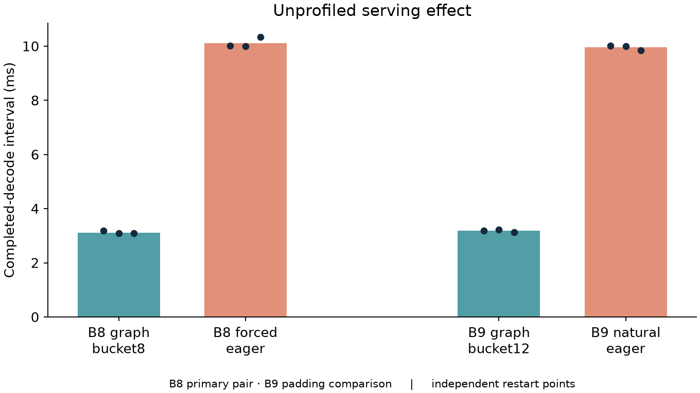
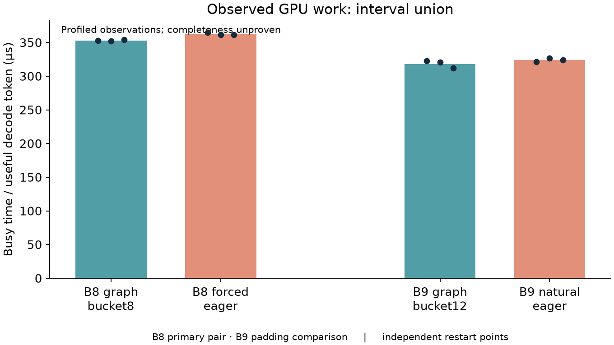
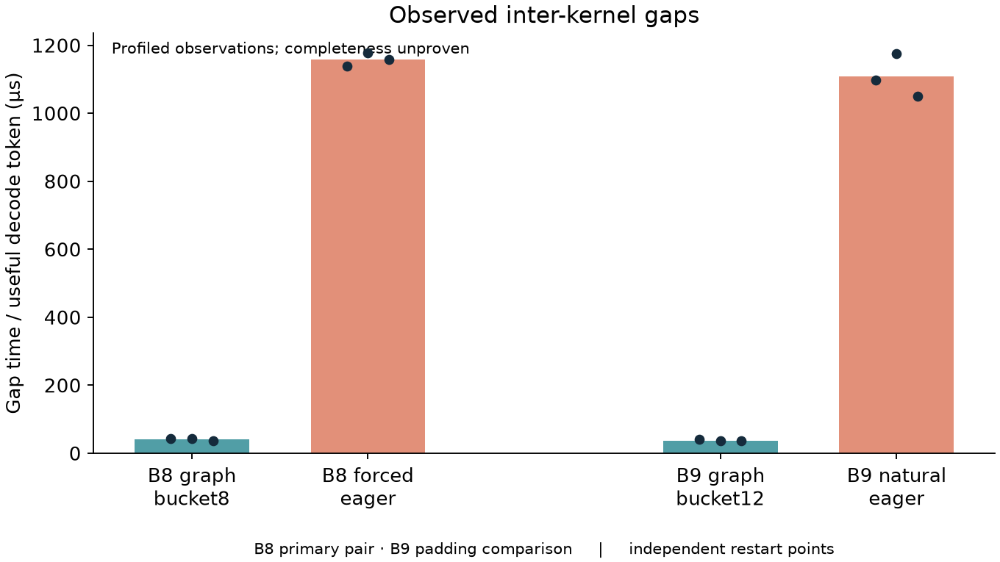
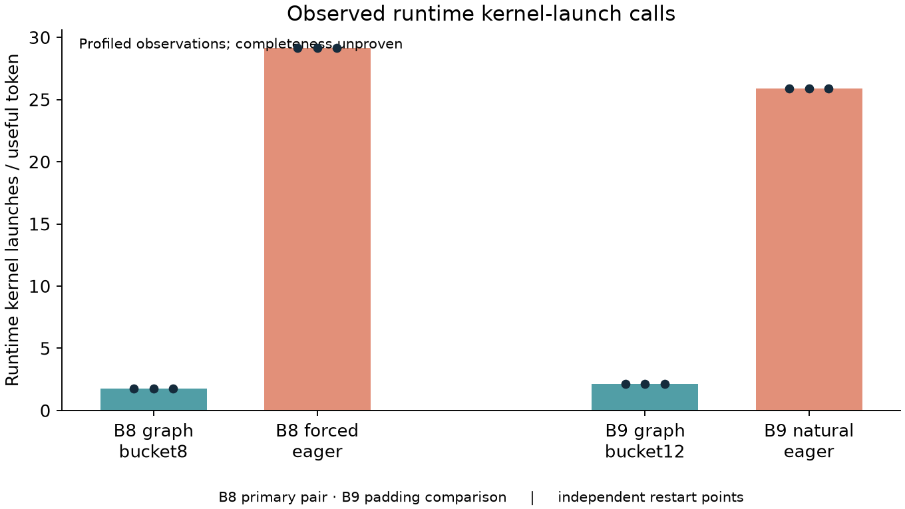
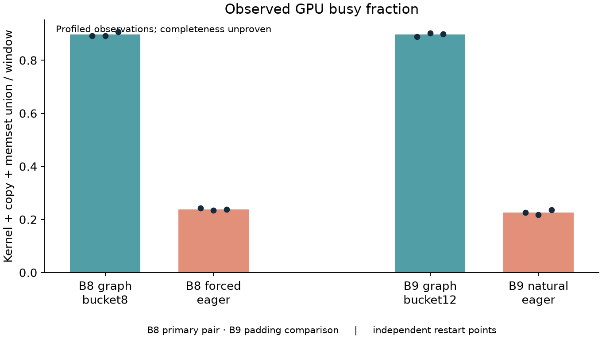
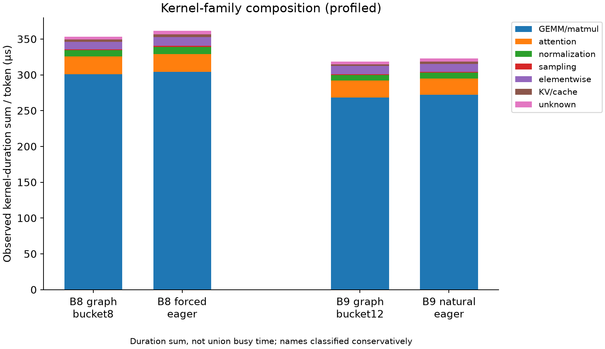

# Phase 2D — controlled GPU trace campaign

**Descriptive evidence only; B8 graph versus B8 forced eager is primary.**

**Unprofiled measurements estimate the serving effect. Profiled measurements describe observed execution structure. Differential profiler perturbation prevents an unbiased absolute latency decomposition.**

## Scope and trace acceptance

All runs use the fixed model revision, BF16/FlashInfer, input length 128, seed 42, greedy generation, forced output length, overlap enabled, radix cache disabled and unchanged prefill policy from Phase 2B/2C. Driver 581.08 differs from the original study. Three excluded warmup cohorts precede each independent server start.

Primary output128: three independent traces per arm, and three separate unprofiled starts per arm with three measured cohorts each. Three rather than five traces bounds the 24-start primary campaign cost; high CV does not trigger selective repetitions. The smaller output256 confirmation covers only the primary B8 pair: two traces per arm and one separate unprofiled start with three cohorts per arm. It begins only after primary acceptance.

| Arm | Policy | Output128 valid traces | Unprofiled starts/cohorts | Output256 valid traces |
|---|---|---:|---:|---:|
| C | B8 graph | 3 | 3/9 | 2 |
| D | B8 forced eager | 3 | 3/9 | 2 |
| B | B9 graph bucket12 | 3 | 3/9 | 0 |
| A | B9 natural eager | 3 | 3/9 | 0 |

Invalid campaign runs: **0**. All attempts remain in trace_manifest.jsonl; no silent replacement. Each accepted trace verifies B/path, actual replay bucket, both submission markers in the GPU worker, the completion window, CLI export, kernel/API correlations and expected graph-launch count. All reported counts remain observed counts, not certified exhaustive totals.

## Measurement regions and normalization

A guarded call in an isolated ModelRunner copy resets a decode counter at prefill and emits two NVTX instant markers at the starts of decode submissions 10 and 80. There is no per-token NVTX range, added GPU synchronization or per-token I/O. The installed package is unchanged. The existing completion observer separately measures endpoints 10→80 for serving cadence.

The primary structured trace region is the time between the two submission markers. GPU activity is clipped to this 70-interval steady-state decode window across all worker streams. Kernel counts include intersecting records; duration distributions use wholly contained kernels. Boundary crossings are recorded. API counts select starts within the window and clip ending durations. This is **GPU activity observed during the steady-state decode measurement window**, not exact per-request GPU attribution. Completion-window results are retained as a sensitivity check.

Normalization uses 70 intervals, B×70 useful decode-token equivalents and B requests; padding slots are excluded. Aggregate throughput and an individual token's latency are distinct. Per-token GPU metrics below are window-normalized observations. Inter-kernel gaps are positive interior gaps between merged kernel intervals, excluding leading/trailing edges. Their fraction uses the first-to-last kernel span. GPU busy/inactive fractions instead use the complete marked region and the union of kernels, copies and memsets. Copy time can lie within a kernel gap, so kernel gaps are not automatically GPU inactivity or CPU overhead.

Nsight 2026.1.3's actual SQLite schema was inspected before implementation and is saved in each parsed summary. Its RUNTIME table contains both runtime cuda* and driver cu* calls; these are separated by name. Runtime kernel launch counts exclude driver-layer duplication. API-duration sums and synchronization waits overlap GPU work; none of these quantities are added to explain the real latency gap.

## Unprofiled serving metrics — source of effect size

Statistics below use independent restart means (three cohorts averaged within each restart). Median/p50 and p95 here describe the three restart means, not a population tail estimate. Detailed cohort and within-cohort p50/p95 values are also exported. SD is sample SD; CV is SD/mean. No confidence interval or steady-state population claim follows from three restarts.

| Arm | Metric | Mean | Median/p50 | SD | CV % | p95 |
|---|---|---:|---:|---:|---:|---:|
| B8 graph | Decode cadence ms | 3.117 | 3.089 | 0.053 | 1.71 | 3.170 |
| B8 graph | Cohort E2E s | 0.420 | 0.416 | 0.007 | 1.78 | 0.428 |
| B8 graph | Useful decode tok/s | 2566.863 | 2590.216 | 43.333 | 1.69 | 2593.181 |
| B8 graph | Full-cohort output tok/s | 2437.478 | 2460.971 | 42.759 | 1.75 | 2463.104 |
| B8 graph | Cohort req/s | 19.043 | 19.226 | 0.334 | 1.75 | 19.243 |
| B8 forced eager | Decode cadence ms | 10.114 | 10.009 | 0.187 | 1.85 | 10.298 |
| B8 forced eager | Cohort E2E s | 1.323 | 1.308 | 0.029 | 2.20 | 1.351 |
| B8 forced eager | Useful decode tok/s | 791.222 | 799.334 | 14.456 | 1.83 | 799.754 |
| B8 forced eager | Full-cohort output tok/s | 774.394 | 782.721 | 16.764 | 2.16 | 785.100 |
| B8 forced eager | Cohort req/s | 6.050 | 6.115 | 0.131 | 2.16 | 6.134 |
| B9 graph bucket12 | Decode cadence ms | 3.180 | 3.190 | 0.049 | 1.53 | 3.220 |
| B9 graph bucket12 | Cohort E2E s | 0.432 | 0.433 | 0.008 | 1.79 | 0.439 |
| B9 graph bucket12 | Useful decode tok/s | 2830.772 | 2821.814 | 43.229 | 1.53 | 2872.182 |
| B9 graph bucket12 | Full-cohort output tok/s | 2665.712 | 2659.760 | 47.738 | 1.79 | 2710.509 |
| B9 graph bucket12 | Cohort req/s | 20.826 | 20.779 | 0.373 | 1.79 | 21.176 |
| B9 natural eager | Decode cadence ms | 9.952 | 9.992 | 0.086 | 0.86 | 10.009 |
| B9 natural eager | Cohort E2E s | 1.309 | 1.309 | 0.004 | 0.28 | 1.312 |
| B9 natural eager | Useful decode tok/s | 904.453 | 900.733 | 7.972 | 0.88 | 912.317 |
| B9 natural eager | Full-cohort output tok/s | 880.409 | 880.124 | 2.567 | 0.29 | 882.809 |
| B9 natural eager | Cohort req/s | 6.878 | 6.876 | 0.020 | 0.29 | 6.897 |

B8 unprofiled eager/graph cadence ratio: **3.244×**. B9 unprofiled eager/graph: **3.130×**. Compare these fresh values with the historical qualitative ordering; do not pool environments.

## Primary B8 and practical B9 pairwise structure

Each profile entry is the mean across three independent traces. Full mean/median/SD/CV/p95 for every numeric metric is in aggregate_metrics.csv; ratios/deltas for all four requested pairs are in pairwise_effects.csv. Busy time includes observed kernel/copy/memset union unless explicitly labeled kernel-only.

### B8 primary

| Metric | Graph | Eager | Eager/graph | Eager − graph |
|---|---:|---:|---:|---:|
| **Unprofiled cadence ms** | 3.117 | 10.114 | 3.244 | 6.997 |
| Observed runtime API calls/token | 7.125 | 37.363 | 5.244 | 30.238 |
| Runtime API duration sum µs/token | 261.868 | 239.284 | 0.914 | -22.584 |
| Runtime kernel launch calls/token | 1.750 | 29.125 | 16.643 | 27.375 |
| Driver API calls/token (separate) | 1.750 | 35.375 | 20.214 | 33.625 |
| Observed kernels/token | 41.393 | 41.374 | 1.000 | -0.019 |
| Kernel-duration sum µs/token | 353.232 | 361.502 | 1.023 | 8.270 |
| Kernel-union busy µs/token | 352.289 | 361.502 | 1.026 | 9.213 |
| GPU-work union µs/token | 352.906 | 362.619 | 1.028 | 9.713 |
| Interior kernel gaps µs/token | 40.955 | 1158.017 | 28.276 | 1117.062 |
| Observed GPU inactive µs/token | 40.343 | 1157.157 | 28.683 | 1116.814 |
| GPU busy fraction | 0.897 | 0.239 | 0.266 | -0.659 |
| Runtime sync calls/token | 0.125 | 0.375 | 3.000 | 0.250 |
| Runtime sync duration sum µs/token | 197.666 | 0.784 | 0.004 | -196.882 |
| Observed graph launches / window | 70.000 | 0.000 | 0.000 | -70.000 |
| Copy union µs/token | 0.732 | 1.077 | 1.472 | 0.345 |
| Active kernel streams | 2.000 | 2.000 | 1.000 | 0.000 |

### B9 practical (padded graph)

| Metric | Graph | Eager | Eager/graph | Eager − graph |
|---|---:|---:|---:|---:|
| **Unprofiled cadence ms** | 3.180 | 9.952 | 3.130 | 6.772 |
| Observed runtime API calls/token | 6.889 | 33.189 | 4.818 | 26.301 |
| Runtime API duration sum µs/token | 228.012 | 227.340 | 0.997 | -0.672 |
| Runtime kernel launch calls/token | 2.111 | 25.889 | 12.263 | 23.778 |
| Driver API calls/token (separate) | 2.111 | 31.444 | 14.895 | 29.333 |
| Observed kernels/token | 37.296 | 36.778 | 0.986 | -0.517 |
| Kernel-duration sum µs/token | 318.616 | 322.776 | 1.013 | 4.160 |
| Kernel-union busy µs/token | 317.700 | 322.776 | 1.016 | 5.075 |
| GPU-work union µs/token | 318.294 | 323.769 | 1.017 | 5.475 |
| Interior kernel gaps µs/token | 37.315 | 1107.577 | 29.682 | 1070.262 |
| Observed GPU inactive µs/token | 36.721 | 1106.693 | 30.138 | 1069.972 |
| GPU busy fraction | 0.897 | 0.227 | 0.253 | -0.670 |
| Runtime sync calls/token | 0.111 | 0.333 | 3.000 | 0.222 |
| Runtime sync duration sum µs/token | 167.630 | 0.759 | 0.005 | -166.870 |
| Observed graph launches / window | 70.000 | 0.000 | 0.000 | -70.000 |
| Copy union µs/token | 0.768 | 0.958 | 1.248 | 0.190 |
| Active kernel streams | 2.000 | 2.000 | 1.000 | 0.000 |

## API, kernel duration and gap distributions

These are means of each trace's event-distribution statistics. Their cross-trace dispersion is separately exported. Positive gap distributions exclude overlapping/adjacent kernel intervals.

| Arm | Distribution | Mean µs | Median µs | p95 µs | Max gap µs |
|---|---|---:|---:|---:|---:|
| B8 graph | Runtime API | 36.753 | 1.245 | 24.748 | — |
| B8 graph | Kernel | 8.533 | 1.440 | 37.429 | — |
| B8 graph | Positive inter-kernel gap | 1.012 | 0.032 | 3.499 | 378.020 |
| B8 forced eager | Runtime API | 6.404 | 6.505 | 11.458 | — |
| B8 forced eager | Kernel | 8.737 | 1.792 | 37.877 | — |
| B8 forced eager | Positive inter-kernel gap | 27.990 | 23.626 | 64.592 | 979.191 |
| B9 graph bucket12 | Runtime API | 33.098 | 1.537 | 24.753 | — |
| B9 graph bucket12 | Kernel | 8.542 | 1.440 | 37.514 | — |
| B9 graph bucket12 | Positive inter-kernel gap | 1.023 | 0.032 | 3.466 | 346.542 |
| B9 natural eager | Runtime API | 6.850 | 6.746 | 14.094 | — |
| B9 natural eager | Kernel | 8.776 | 1.749 | 37.802 | — |
| B9 natural eager | Positive inter-kernel gap | 30.116 | 24.085 | 73.154 | 798.791 |

## Kernel composition, streams and padding

Full demangled names, clipped cumulative time, count and grid/block dimensions are preserved in kernel_composition.csv and individual JSON summaries. Classification is name-based and conservative. An attention kernel named BatchPrefillWithPagedKVCache can execute in decode; its name does not establish that prefill leaked into the window. Ambiguous reduction, positional and metadata kernels remain unknown.

| Arm | Family | Mean cumulative µs/token |
|---|---|---:|
| B8 graph | GEMM/matmul | 301.074 |
| B8 graph | attention | 24.879 |
| B8 graph | normalization | 8.579 |
| B8 graph | sampling | 1.260 |
| B8 graph | elementwise | 10.475 |
| B8 graph | KV/cache | 2.885 |
| B8 graph | unknown | 4.080 |
| B8 forced eager | GEMM/matmul | 304.334 |
| B8 forced eager | attention | 24.717 |
| B8 forced eager | normalization | 10.129 |
| B8 forced eager | sampling | 1.406 |
| B8 forced eager | elementwise | 12.267 |
| B8 forced eager | KV/cache | 3.588 |
| B8 forced eager | unknown | 5.061 |
| B9 graph bucket12 | GEMM/matmul | 268.151 |
| B9 graph bucket12 | attention | 23.722 |
| B9 graph bucket12 | normalization | 7.870 |
| B9 graph bucket12 | sampling | 1.184 |
| B9 graph bucket12 | elementwise | 11.351 |
| B9 graph bucket12 | KV/cache | 2.559 |
| B9 graph bucket12 | unknown | 3.780 |
| B9 natural eager | GEMM/matmul | 272.454 |
| B9 natural eager | attention | 22.116 |
| B9 natural eager | normalization | 8.413 |
| B9 natural eager | sampling | 1.277 |
| B9 natural eager | elementwise | 10.888 |
| B9 natural eager | KV/cache | 3.171 |
| B9 natural eager | unknown | 4.457 |

B8 observed name sets: 25 shared, 0 graph-only, 0 eager-only. Equal names do not prove equal shapes or work; see preserved shape histograms.

B9 observed name sets: 25 shared, 2 graph-only, 0 eager-only. Equal names do not prove equal shapes or work; see preserved shape histograms.

Top five exact kernel names per arm by average observed cumulative time/token (name wrapping is intentional):

### B8 graph

| Kernel | µs/token | Mean observed count |
|---|---:|---:|
| `void cutlass::Kernel2<cutlass_80_wmma_tensorop_bf16_s161616gemm_bf16_16x16_128x2_tn_align8>(T1::Params)` | 224.274 | 6723.7 |
| `void cutlass::Kernel2<cutlass_80_wmma_tensorop_bf16_s161616gemm_bf16_16x16_128x1_tn_align8>(T1::Params)` | 73.441 | 70.0 |
| `void flashinfer::BatchPrefillWithPagedKVCacheKernel<flashinfer::KernelTraits<(flashinfer::MaskMode)0, (unsigned int)16, (unsigned int)1, (unsigned int)2, (unsigned int)4, (unsigned int)4, (unsigned int)1, (unsigned int)4, (flashinfer::PosEncodingMode)0, __nv_bfloat16, __nv_bfloat16, __nv_bfloat16, float, int, flashinfer::DefaultAttention<(bool)0, (bool)0, (bool)0, (bool)0>>, PagedParams>(T2)` | 18.249 | 1680.7 |
| `kernel_cutlass_kernel_flashinfernormkernelsfused_add_rmsnormFusedAddRMSNormKernel_object_at__tensorptrbf16gmemalign128oi648968961_tensorptrbf16gmemalign128oi648968961_tensorptrbf16gmemali_0` | 8.423 | 3361.3 |
| `void flashinfer::PersistentVariableLengthMergeStatesKernel<(unsigned int)8, (unsigned int)8, (unsigned int)16, (unsigned int)4, __nv_bfloat16, __nv_bfloat16, int>(T5 *, float *, T7 *, T6 *, float *, unsigned int, unsigned int *, unsigned int)` | 6.630 | 1680.7 |
### B8 forced eager

| Kernel | µs/token | Mean observed count |
|---|---:|---:|
| `void cutlass::Kernel2<cutlass_80_wmma_tensorop_bf16_s161616gemm_bf16_16x16_128x2_tn_align8>(T1::Params)` | 226.616 | 6720.0 |
| `void cutlass::Kernel2<cutlass_80_wmma_tensorop_bf16_s161616gemm_bf16_16x16_128x1_tn_align8>(T1::Params)` | 73.585 | 70.0 |
| `void flashinfer::BatchPrefillWithPagedKVCacheKernel<flashinfer::KernelTraits<(flashinfer::MaskMode)0, (unsigned int)16, (unsigned int)1, (unsigned int)2, (unsigned int)4, (unsigned int)4, (unsigned int)1, (unsigned int)4, (flashinfer::PosEncodingMode)0, __nv_bfloat16, __nv_bfloat16, __nv_bfloat16, float, int, flashinfer::DefaultAttention<(bool)0, (bool)0, (bool)0, (bool)0>>, PagedParams>(T2)` | 17.130 | 1680.0 |
| `kernel_cutlass_kernel_flashinfernormkernelsfused_add_rmsnormFusedAddRMSNormKernel_object_at__tensorptrbf16gmemalign128oi648968961_tensorptrbf16gmemalign128oi648968961_tensorptrbf16gmemali_0` | 9.942 | 3360.0 |
| `void flashinfer::PersistentVariableLengthMergeStatesKernel<(unsigned int)8, (unsigned int)8, (unsigned int)16, (unsigned int)4, __nv_bfloat16, __nv_bfloat16, int>(T5 *, float *, T7 *, T6 *, float *, unsigned int, unsigned int *, unsigned int)` | 7.587 | 1680.0 |
### B9 graph bucket12

| Kernel | µs/token | Mean observed count |
|---|---:|---:|
| `void cutlass::Kernel2<cutlass_80_wmma_tensorop_bf16_s161616gemm_bf16_16x16_128x2_tn_align8>(T1::Params)` | 198.354 | 6713.3 |
| `void cutlass::Kernel2<cutlass_80_wmma_tensorop_bf16_s161616gemm_bf16_16x16_128x1_tn_align8>(T1::Params)` | 66.596 | 70.0 |
| `void flashinfer::BatchPrefillWithPagedKVCacheKernel<flashinfer::KernelTraits<(flashinfer::MaskMode)0, (unsigned int)16, (unsigned int)1, (unsigned int)2, (unsigned int)4, (unsigned int)4, (unsigned int)1, (unsigned int)4, (flashinfer::PosEncodingMode)0, __nv_bfloat16, __nv_bfloat16, __nv_bfloat16, float, int, flashinfer::DefaultAttention<(bool)0, (bool)0, (bool)0, (bool)0>>, PagedParams>(T2)` | 17.735 | 1678.3 |
| `kernel_cutlass_kernel_flashinfernormkernelsfused_add_rmsnormFusedAddRMSNormKernel_object_at__tensorptrbf16gmemalign128oi648968961_tensorptrbf16gmemalign128oi648968961_tensorptrbf16gmemali_0` | 7.732 | 3356.3 |
| `void flashinfer::PersistentVariableLengthMergeStatesKernel<(unsigned int)8, (unsigned int)8, (unsigned int)16, (unsigned int)4, __nv_bfloat16, __nv_bfloat16, int>(T5 *, float *, T7 *, T6 *, float *, unsigned int, unsigned int *, unsigned int)` | 5.986 | 1678.3 |
### B9 natural eager

| Kernel | µs/token | Mean observed count |
|---|---:|---:|
| `void cutlass::Kernel2<cutlass_80_wmma_tensorop_bf16_s161616gemm_bf16_16x16_128x2_tn_align8>(T1::Params)` | 201.345 | 6720.0 |
| `void cutlass::Kernel2<cutlass_80_wmma_tensorop_bf16_s161616gemm_bf16_16x16_128x1_tn_align8>(T1::Params)` | 67.509 | 70.0 |
| `void flashinfer::BatchPrefillWithPagedKVCacheKernel<flashinfer::KernelTraits<(flashinfer::MaskMode)0, (unsigned int)16, (unsigned int)1, (unsigned int)2, (unsigned int)4, (unsigned int)4, (unsigned int)1, (unsigned int)4, (flashinfer::PosEncodingMode)0, __nv_bfloat16, __nv_bfloat16, __nv_bfloat16, float, int, flashinfer::DefaultAttention<(bool)0, (bool)0, (bool)0, (bool)0>>, PagedParams>(T2)` | 15.558 | 1680.0 |
| `kernel_cutlass_kernel_flashinfernormkernelsfused_add_rmsnormFusedAddRMSNormKernel_object_at__tensorptrbf16gmemalign128oi648968961_tensorptrbf16gmemalign128oi648968961_tensorptrbf16gmemali_0` | 8.243 | 3360.0 |
| `void flashinfer::PersistentVariableLengthMergeStatesKernel<(unsigned int)8, (unsigned int)8, (unsigned int)16, (unsigned int)4, __nv_bfloat16, __nv_bfloat16, int>(T5 *, float *, T7 *, T6 *, float *, unsigned int, unsigned int *, unsigned int)` | 6.557 | 1680.0 |

B9 graph/bucket12 versus B8 graph/bucket8: kernel-duration sum per token ratio **0.902**, GPU-work union per token ratio **0.902**. Per-step kernel-work ratio (removing useful-token denominator change) is **1.015**. This comparison changes useful B and padded bucket together; it cannot isolate padding cost. Copy activity is observable but DRAM/L2 traffic is not measured.

| Arm | Kernel streams | Kernel overlap excess µs/token | Kernel-gap fraction | Submission − completion busy fraction (pp) |
|---|---:|---:|---:|---:|
| B8 graph | 2.0 | 0.942 | 0.104 | -0.057 |
| B8 forced eager | 2.0 | 0.000 | 0.762 | -0.000 |
| B9 graph bucket12 | 2.0 | 0.916 | 0.105 | 0.033 |
| B9 natural eager | 2.0 | 0.000 | 0.774 | -0.012 |

Stream IDs are process-local identifiers, not semantic roles. Kernel interval overlap and active-stream counts describe serialization; kernel overlap excess is duration-sum minus union and not itself a percentage of simultaneous occupancy. Graph arms require exactly 70 observed runtime graph launches per window; individual runtime kernel launches can remain outside graphs (for example surrounding runtime work).

B9 bucket12 shows larger recorded launch grids: KV-index and RoPE grids grow from 8 to 12 blocks, normalization and KV-store from 2 to 3, and an activation grid from 19 to 29. Two additional FillFunctor kernels appear. The dominant CUTLASS GEMM launch grids remain unchanged. These are launch dimensions, not full tensor shapes. Copy-union time per step rises from 5.853 to 6.910 µs (+18.0%), while kernel-duration sum per step rises only 1.47%. That small timing difference is comparable to B9 graph cross-trace variation (1.69% CV); isolated padding cost is not established. Both graph arms retain 70 launches per window.

## Cross-trace stability and profiler perturbation

CV >10% is a warning, not an exclusion rule. CV uses SD/absolute mean; near-zero signed diagnostic deltas can have enormous CV, so their absolute percentage-point SD matters more. Only three primary traces per arm are available, so extreme-event p95/max estimates can vary. The raw trace metrics, every CV and all flagged metrics remain exported.

| Metric CV % | B8 graph | B8 eager | B9 graph | B9 eager |
|---|---:|---:|---:|---:|
| Observed runtime API calls/token | 0.00 | 0.08 | 0.00 | 0.12 |
| Runtime API duration sum µs/token | 2.63 | 1.23 | 6.02 | 6.49 |
| Runtime kernel launch calls/token | 0.00 | 0.00 | 0.00 | 0.00 |
| Driver API calls/token (separate) | 0.00 | 0.00 | 0.00 | 0.00 |
| Observed kernels/token | 0.03 | 0.00 | 0.18 | 0.00 |
| Kernel-duration sum µs/token | 0.27 | 0.45 | 1.69 | 0.84 |
| Kernel-union busy µs/token | 0.27 | 0.45 | 1.69 | 0.84 |
| GPU-work union µs/token | 0.27 | 0.45 | 1.69 | 0.85 |
| Interior kernel gaps µs/token | 8.16 | 1.61 | 8.03 | 5.65 |
| Observed GPU inactive µs/token | 8.32 | 1.62 | 8.15 | 5.65 |
| GPU busy fraction | 0.88 | 1.55 | 0.73 | 3.98 |
| Runtime sync calls/token | 0.00 | 0.00 | 0.00 | 0.00 |
| Runtime sync duration sum µs/token | 3.60 | 2.33 | 9.58 | 10.00 |
| Observed graph launches / window | 0.00 | — | 0.00 | — |
| Copy union µs/token | 2.94 | 2.66 | 1.03 | 4.09 |
| Active kernel streams | 0.00 | 0.00 | 0.00 | 0.00 |

Primary metric/arm entries with CV>10%: **24** (including derived and tail metrics). No such entry is silently removed.

| Arm | Cadence perturbation mean % | SD (percentage points) | E2E perturbation mean % |
|---|---:|---:|---:|
| B8 graph | 0.95 | 1.19 | 0.84 |
| B8 forced eager | 20.24 | 2.73 | 20.95 |
| B9 graph bucket12 | 0.69 | 1.30 | 0.81 |
| B9 natural eager | 29.25 | 4.88 | 28.46 |

Each perturbation comparison matches arm/output length/block but uses separate server starts. Nsight software instrumentation and environment drift are both included. No profiled absolute serving-time difference is assigned to launch, gap, sync or compute causes.

## Output256 confirmation

| Arm | Unprofiled cadence mean ms | Cohort E2E mean s | Trace GPU busy µs/token | Trace gap µs/token | Valid traces |
|---|---:|---:|---:|---:|---:|
| B8 graph | 3.608 | 0.951 | 364.828 | 43.724 | 2 |
| B8 forced eager | 10.380 | 2.693 | 354.889 | 1255.772 | 2 |

Only one unprofiled restart per output256 arm is available; restart SD is unavailable. Two traces provide limited confirmation, not a formal output-length interaction estimate. All comparisons use the same early decode window; no longer-context conclusion follows.

## Data quality and descriptive answers

All captures retain Nsight's CUDA/NVTX completeness warnings. Hardware tracing is unsupported, so software tracing was used. Unified Memory tracking is unavailable; no memory-bandwidth conclusion is made. Missing auxiliary-process CUDA events are distinguished from worker warnings. All observed selected kernels have worker API correlations; that does not rule out jointly missing API/kernel records. Structural acceptance is not exhaustive-record certification.

Reliable observations are the verified paths/buckets, observed graph-launch pattern, observed event names/shapes, marked steady region and cross-trace reproducibility of recorded metrics. Event sums, busy fractions and gaps are conditional on captured records. Missing work can reduce observed busy time and inflate observed gaps; stable repeated results do not mathematically prove completeness.

The report separates: (1) the repeated unprofiled serving effect; (2) repeated profiled launch/API structure; (3) recorded GPU work/gaps and kernel composition. Pairwise tables show whether GPU work changes are smaller than serving cadence changes without equating the two timing environments. Larger gaps are not labeled CPU launch overhead. Synchronization duration is blocking API time and can overlap GPU execution; more graph-side waiting would not imply a larger serving cost.

The B9 graph comparison changes both useful B and bucket size. Name/shape histograms and per-step versus per-token work quantify the observed difference but cannot isolate padding. Kernel-duration sums do not measure DRAM traffic or occupancy. No hypothesis is promoted to a final mechanism claim here.

The ten descriptive questions have the following answers: the serving effect reproduces (3.244× B8, 3.130× B9); central structural metrics repeat stably; eager has more API calls but not greater summed API duration; eager has 16.643×/12.263× more individual runtime kernel launches; observed gaps are 28.276×/29.682× larger; observed GPU-work union differs by only 2.75%/1.72%; all 25 B8 kernel names are shared and B9 adds two fill kernels; padding changes launch grids but its isolated timing cost remains unresolved; path/bucket and repeated observed structure are dependable within the coverage limitations; those observations support cautious Phase 2E analysis, not exhaustive causal accounting.

Flag investigation: the 24 primary CV warnings concentrate in edge/boundary diagnostics, signed window differences near zero, and API/gap tail statistics. Submission-minus-completion busy-fraction SD is 0.044/0.031/0.116/0.043 percentage points for B8 graph/eager and B9 graph/eager, despite some very large relative CVs. Maximum-gap CV reaches 24.16% and API p95 CV 26.91%; these tails are not used as stable effect-size estimates. B9 eager sync-time CV is 10.004%, on a mean of only 0.759 µs/token. B9 graph elementwise time CV is 13.63%, so family-level fine differences remain tentative. No runs are removed or selectively repeated. Secondary warnings remain in the same aggregate export (33 total flagged metric/arm/output entries).

Measurement and instrumentation implementations were fixed throughout collection; commits during collection added downstream analysis/reporting. A subsequent observer docstring correction changes no executable behavior. Every run preserves its exact pipeline hashes.

## Artifacts, figures and validation

- trace_manifest.jsonl indexes every attempt; runs/ contains immutable manifests; ignored traces/ retains raw reports and summaries/ retains SQLite plus compact parsed evidence.
- trace_metrics.csv, aggregate_metrics.csv and pairwise_effects.csv preserve actual values, all cross-trace statistics, ratios and deltas.
- unprofiled_* files preserve restart/cohort statistics; profiler_perturbation.csv keeps the two measurement roles separate.
- kernel_composition.csv and kernel_families.csv preserve names, counts, shapes and conservative classification.

Test and preservation results are recorded separately in validation_checks.json. Historical archives and Phase 2B/2C outputs were not overwritten. No Nsight Compute, custom CUDA kernels, parameter tuning or push was performed.

**READY FOR PHASE 2E — MECHANISM ANALYSIS**

The repeated observed structure and independently measured serving effect support proceeding to cautious mechanism analysis. Readiness does not certify exhaustive counts or precise GPU attribution. Resolve worker completeness warnings or establish independent event coverage before claims that depend on exhaustive accounting. Do not treat the profiler's gap increase as an unbiased decomposition of the unprofiled ~3× effect, and do not promote these descriptive observations to a final causal mechanism claim.
