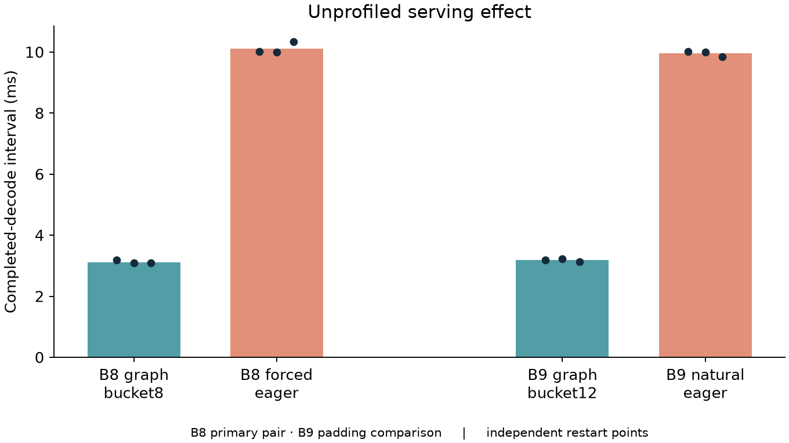
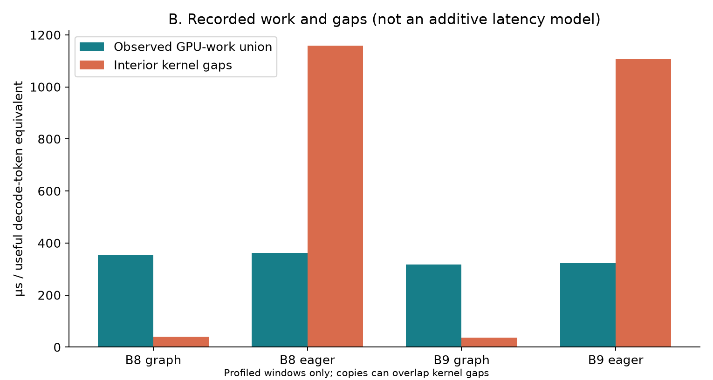
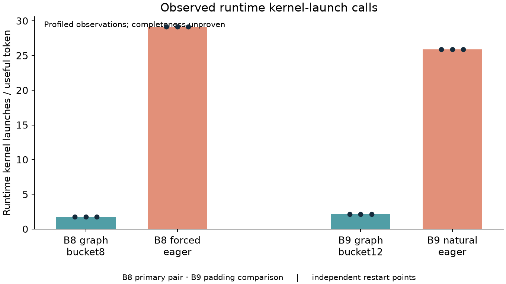
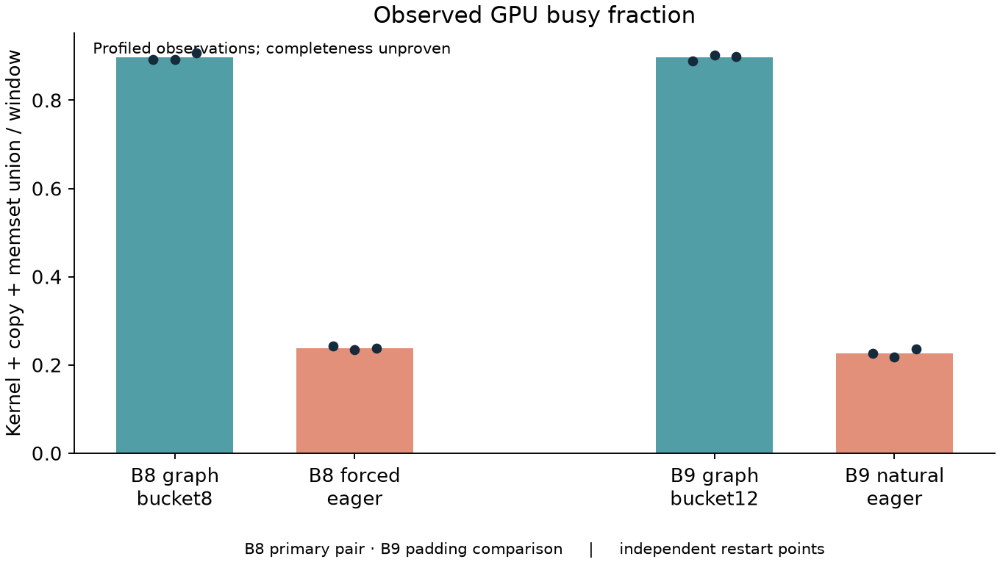
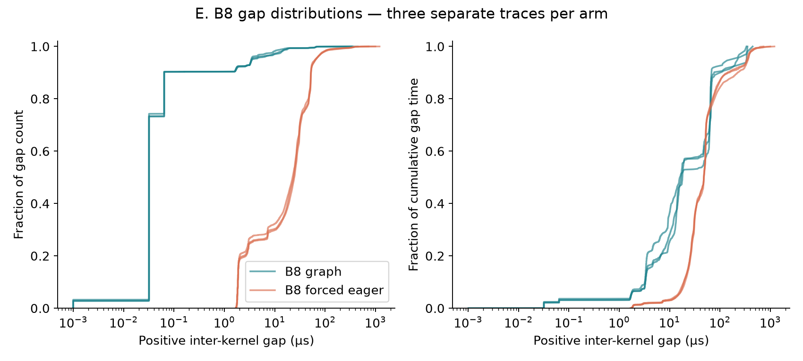
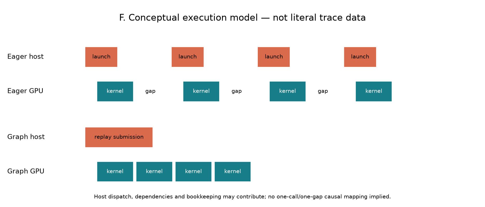

# Phase 2E — mechanism analysis and targeted falsification

**Claim level 2: STRONG MECHANISM EVIDENCE. B8 is the primary controlled comparison.**

Repeated controlled observations strongly support host-driven/runtime orchestration and launch structure as the primary mechanism behind the graph/eager service difference. They do not establish that every GPU gap is CPU launch execution time, nor quantify an exact causal decomposition of real serving latency.

## 1. Research question and scope

Which competing mechanism best explains the approximately 3× service-rate change? This phase performs read-only analysis of all 16 accepted Phase 2D SQLite traces: three per primary arm and two per output256 B8 arm. No new GPU capture, microbenchmark, tuning or Nsight Compute run was performed. Source traces, archived results and Phase 2D artifacts are preserved.

The fixed model is Qwen2.5-0.5B-Instruct at the recorded revision on RTX 4070, BF16/FlashInfer, input128, with overlap enabled. All configuration and environment details remain in the Phase 2D manifests. Generalization to other models, devices, policies or contexts is untested.

## 2. Controlled evidence

**Unprofiled measurements estimate the serving effect; profiled records describe execution structure.** Primary statistics use three independent server starts per arm, three measured cohorts per unprofiled start. No event-level sample size is substituted for independent traces. Mean ± sample SD is used instead of a fragile confidence interval from n=3.

| Arm | Unprofiled decode ms, mean ± SD | E2E s, mean ± SD | Useful decode tok/s | Primary traces |
|---|---:|---:|---:|---:|
| B8 graph | 3.117 ± 0.053 | 0.420 ± 0.007 | 2,566.9 | 3 |
| B8 forced eager | 10.114 ± 0.187 | 1.323 ± 0.029 | 791.2 | 3 |
| B9 graph bucket12 | 3.180 ± 0.049 | 0.432 ± 0.008 | 2,830.8 | 3 |
| B9 natural eager | 9.952 ± 0.086 | 1.309 ± 0.004 | 904.5 | 3 |

Eager/graph cadence ratio: **3.244× B8**, **3.130× B9**. B8 changes execution policy at the same useful batch without padding; B9 graph additionally uses bucket12.

### B8 primary: observed structure

| Metric | Graph mean ± SD | Eager mean ± SD | Eager/graph | Eager − graph |
|---|---:|---:|---:|---:|
| GPU-work union µs/token | 352.906 ± 0.970 | 362.619 ± 1.643 | 1.028 | 9.713 |
| Kernel-duration sum µs/token | 353.232 ± 0.939 | 361.502 ± 1.615 | 1.023 | 8.270 |
| Interior kernel gaps µs/token | 40.955 ± 3.343 | 1,158.017 ± 18.626 | 28.276 | 1,117.062 |
| GPU busy fraction | 0.897 ± 0.008 | 0.239 ± 0.004 | 0.266 | -0.659 |
| Runtime individual launches/token | 1.750 ± 0.000 | 29.125 ± 0.000 | 16.643 | 27.375 |
| Graph launches/window | 70.000 ± 0.000 | 0.000 ± 0.000 | 0.000 | -70.000 |
| Runtime API calls/token | 7.125 ± 0.000 | 37.363 ± 0.031 | 5.244 | 30.238 |
| Runtime API duration µs/token | 261.868 ± 6.875 | 239.284 ± 2.939 | 0.914 | -22.584 |
| Sync calls/token | 0.125 ± 0.000 | 0.375 ± 0.000 | 3.000 | 0.250 |
| Sync duration µs/token | 197.666 ± 7.125 | 0.784 ± 0.018 | 0.004 | -196.882 |
| GEMM µs/token | 301.074 ± 1.522 | 304.334 ± 1.486 | 1.011 | 3.261 |

### B9 practical: observed structure

| Metric | Graph mean ± SD | Eager mean ± SD | Eager/graph | Eager − graph |
|---|---:|---:|---:|---:|
| GPU-work union µs/token | 318.294 ± 5.373 | 323.769 ± 2.737 | 1.017 | 5.475 |
| Kernel-duration sum µs/token | 318.616 ± 5.381 | 322.776 ± 2.711 | 1.013 | 4.160 |
| Interior kernel gaps µs/token | 37.315 ± 2.996 | 1,107.577 ± 62.629 | 29.682 | 1,070.262 |
| GPU busy fraction | 0.897 ± 0.007 | 0.227 ± 0.009 | 0.253 | -0.670 |
| Runtime individual launches/token | 2.111 ± 0.000 | 25.889 ± 0.000 | 12.263 | 23.778 |
| Graph launches/window | 70.000 ± 0.000 | 0.000 ± 0.000 | 0.000 | -70.000 |
| Runtime API calls/token | 6.889 ± 0.000 | 33.189 ± 0.040 | 4.818 | 26.301 |
| Runtime API duration µs/token | 228.012 ± 13.731 | 227.340 ± 14.762 | 0.997 | -0.672 |
| Sync calls/token | 0.111 ± 0.000 | 0.333 ± 0.000 | 3.000 | 0.222 |
| Sync duration µs/token | 167.630 ± 16.067 | 0.759 ± 0.076 | 0.005 | -166.870 |
| GEMM µs/token | 268.151 ± 4.452 | 272.454 ± 1.812 | 1.016 | 4.304 |

## 3. Competing hypotheses

### B8 primary

| Hypothesis | Required observation | Observed evidence | Assessment | Confidence | Limitations |
|---|---|---|---|---|---|
| H1 More GPU compute | Eager GPU work comparable to the ~3× serving ratio | GPU-work ratio 1.028; GEMM ratio 1.011 | Contradicts dominant explanation | High within captured work | Duration is not FLOP count; incomplete traces and small compute differences remain |
| H2 Different computational path | Different dominant names/families/sequence | 25 shared names; zero mode-only names; exact sequence comparisons below | Contradicts dominant explanation | High for observed names; moderate for full workload | Equal names do not prove equal shapes, inputs or dependencies; B9 has padding |
| H3 Host/runtime orchestration bubbles | Similar GPU work; more individual launches, much larger gaps and lower density | Launch ratio 16.643; gap ratio 28.276; eager gap successors all correlated to individual launches | Supports strongest mechanism | Strong, level 2 | Correlation is not an intervention on host dispatch; dependencies, driver and tracing effects remain |
| H4 Synchronization-dominated eager | Eager blocking wait time dominates | Eager sync count 3× graph but duration 0.784 versus 197.666 µs/token | Contradicts explicit-sync-time explanation | High for recorded explicit APIs | Implicit/device synchronization and dependencies are not all measured |
| H5 Much faster GPU kernels under graph | Large shared-kernel duration reduction sufficient for ~3× effect | Kernel-duration-sum ratio 1.023; GEMM dominates both | Weak secondary effects; contradicts dominant explanation | Moderate to high | Some small kernels differ materially; duration includes environment and tracing effects |
| H6 Pure profiler artifact | Serving effect absent unprofiled, or structural difference fails replication | Unprofiled ~3× effect; stable repeated structure; B8 output256 retains gap/work contrast | Contradicts pure serving artifact; structural inflation unresolved | High for real serving effect; moderate for unprofiled structure | Stable instrumentation can induce stable bias; repetition cannot exclude systematic structural distortion |

### B9 practical

| Hypothesis | Required observation | Observed evidence | Assessment | Confidence | Limitations |
|---|---|---|---|---|---|
| H1 More GPU compute | Eager GPU work comparable to the ~3× serving ratio | GPU-work ratio 1.017; GEMM ratio 1.016 | Contradicts dominant explanation | High within captured work | Duration is not FLOP count; incomplete traces and small compute differences remain |
| H2 Different computational path | Different dominant names/families/sequence | 25 shared names; two additional graph fill kernels; exact sequence comparisons below | Contradicts dominant explanation | High for observed names; moderate for full workload | Equal names do not prove equal shapes, inputs or dependencies; B9 has padding |
| H3 Host/runtime orchestration bubbles | Similar GPU work; more individual launches, much larger gaps and lower density | Launch ratio 12.263; gap ratio 29.682; eager gap successors all correlated to individual launches | Supports strongest mechanism | Strong, level 2 | Correlation is not an intervention on host dispatch; dependencies, driver and tracing effects remain |
| H4 Synchronization-dominated eager | Eager blocking wait time dominates | Eager sync count 3× graph but duration 0.759 versus 167.630 µs/token | Contradicts explicit-sync-time explanation | High for recorded explicit APIs | Implicit/device synchronization and dependencies are not all measured |
| H5 Much faster GPU kernels under graph | Large shared-kernel duration reduction sufficient for ~3× effect | Kernel-duration-sum ratio 1.013; GEMM dominates both | Weak secondary effects; contradicts dominant explanation | Moderate to high | Some small kernels differ materially; duration includes environment and tracing effects |
| H6 Pure profiler artifact | Serving effect absent unprofiled, or structural difference fails replication | Unprofiled ~3× effect; stable repeated structure; B8 output256 retains gap/work contrast | Contradicts pure serving artifact; structural inflation unresolved | High for real serving effect; moderate for unprofiled structure | Stable instrumentation can induce stable bias; repetition cannot exclude systematic structural distortion |

## 4. GPU computation and sequence comparison

Kernels are ordered by GPU start time, with deterministic end/stream/name tie breaks. Exact longest-common-subsequence similarity is 2LCS/(Ngraph+Neager), computed with bitset dynamic programming; repeated names are retained. All nine cross-trace pairings are descriptive sensitivity comparisons, not nine independent experiments. Cross-stream ordering is not a dependency graph. Dominant-stream comparisons reduce that ordering sensitivity.

| Pair | Sequence | Mean similarity | Min–max |
|---|---|---:|---:|
| B8 | all_names | 98.442% | 98.399–98.507% |
| B8 | all_families | 98.448% | 98.404–98.513% |
| B8 | dominant_stream_names | 99.635% | 99.589–99.701% |
| B9 | all_names | 97.713% | 97.606–97.770% |
| B9 | all_families | 98.611% | 98.509–98.668% |
| B9 | dominant_stream_names | 98.888% | 98.782–98.947% |
| graph_padding | all_names | 98.093% | 98.003–98.167% |
| graph_padding | all_families | 98.268% | 98.177–98.341% |
| graph_padding | dominant_stream_names | 99.137% | 99.047–99.237% |
| B8_output256 | all_names | 98.534% | 98.505–98.563% |
| B8_output256 | all_families | 98.540% | 98.513–98.568% |
| B8_output256 | dominant_stream_names | 99.729% | 99.701–99.757% |

Repeated layer patterns can make LCS high even when some events differ. This is evidence of observed ordering similarity, not proof of equal tensors or work. Boundary clipping and cross-stream reordering account for some mismatch; they are not assumed to explain all mismatch.

Per-kernel duration distributions use wholly contained records. Counts include intersecting records; cumulative time is clipped and normalized. The following B8 top kernels are ranked by graph cumulative time; full demangled names and all 25 comparisons are in kernel_comparisons.csv. Entries are averages of per-trace means/medians, avoiding pooled-event pseudoreplication.

| B8 shared kernel (abbreviated) | Count graph/eager | Mean µs graph/eager | Median µs graph/eager | Cumulative µs/token graph/eager |
|---|---:|---:|---:|---:|
| CUTLASS GEMM 128x2 | 6,723.667 / 6,720.000 | 18.681 / 18.885 | 19.893 / 20.463 | 224.274 / 226.616 |
| CUTLASS GEMM 128x1 | 70.000 / 70.000 | 587.525 / 588.684 | 571.760 / 572.970 | 73.441 / 73.585 |
| FlashInfer attention | 1,680.667 / 1,680.000 | 6.081 / 5.710 | 5.941 / 5.642 | 18.249 / 17.130 |
| Fused add RMSNorm | 3,361.333 / 3,360.000 | 1.403 / 1.657 | 1.387 / 1.664 | 8.423 / 9.942 |
| Merge attention states | 1,680.667 / 1,680.000 | 2.209 / 2.529 | 2.208 / 2.528 | 6.630 / 7.587 |
| void at::native::elementwise_kernel<(int)128, (int)4, void at::native::gpu_kerne | 1,680.667 / 1,680.000 | 1.373 / 1.831 | 1.376 / 1.802 | 4.120 / 5.494 |
| void cublasLt::splitKreduce_kernel<(int)32, (int)16, int, __nv_bfloat16, __nv_bf | 1,680.667 / 1,680.000 | 1.119 / 1.378 | 1.120 / 1.376 | 3.359 / 4.133 |
| Activation and multiply | 1,680.667 / 1,680.000 | 1.020 / 1.236 | 1.024 / 1.237 | 3.063 / 3.709 |

B8 GEMM cumulative time changes by only 1.08% eager/graph and accounts for roughly 85% of graph kernel time. Smaller families do differ: normalization is 8.579→10.129 µs/token (+18.1%), elementwise 10.475→12.267 (+17.1%), KV/cache 2.885→3.588 (+24.4%). These effects are not dismissed, but their small absolute contributions cannot account descriptively for a 3.244× serving ratio. Without hardware counters, neither equal FLOPs nor intrinsic kernel efficiency is established.

## 5. Launch structure and event association

Matches use the same worker and correlationId over the entire captured worker API set, allowing calls before the marked window to launch work inside it. The unique runtime individual launch is preferred; otherwise a unique driver individual launch is used. Ambiguous, absent and impossible-order matches are excluded rather than replaced with nearest-time guesses. Graph correlations remain many-kernels-to-one replay. No runtime/driver records are summed as independent launches for the same kernel.

| Arm | Runtime-matched kernels/window | Driver-matched | Graph-replay-matched | Unmatched/ambiguous |
|---|---:|---:|---:|---:|
| B8 graph | 980.0 | 70.0 | 22,130.3 | 0.0 |
| B8 forced eager | 16,309.7 | 6,860.0 | 0.0 | 0.0 |
| B9 graph bucket12 | 1,330.0 | 70.0 | 22,096.3 | 0.0 |
| B9 natural eager | 16,310.3 | 6,860.0 | 0.0 | 0.0 |

For eager, every observed gap successor is uniquely matched, covering 100% of recorded gap count and time. Individual matched APIs each map to one selected eager kernel; graph replay is explicitly not one-to-one. This validates a record-level association, not event completeness.

| Eager arm | Launch starts inside preceding gap | Gap time before matched API entry | During matched API | After API return |
|---|---:|---:|---:|---:|
| B8 forced eager | 48.65% | 26.14% | 14.67% | 59.19% |
| B9 natural eager | 45.20% | 25.14% | 13.80% | 61.06% |

Each positive union gap is partitioned relative to the matched next kernel’s API entry/return. The portions sum to that gap, but are not causal components. A launch already submitted before a gap may still await dependencies, driver scheduling or GPU readiness. Work on other streams, copies and tracing can also affect interpretation.

| Eager arm | Matched layer | Return→kernel mean µs | Median µs | p95 µs |
|---|---|---:|---:|---:|
| B8 forced eager | runtime_individual | 41.977 | 23.251 | 130.722 |
| B8 forced eager | driver_individual | 28.056 | 18.084 | 58.808 |
| B9 natural eager | runtime_individual | 49.389 | 24.548 | 195.036 |
| B9 natural eager | driver_individual | 35.751 | 20.022 | 127.149 |

Negative return→kernel delays are retained: asynchronous work can start before the CPU call returns. These distributions are not a host-overhead estimate. In graph mode the remaining individual launches can queue milliseconds ahead (B8 runtime median about 2,393 µs), despite faster serving and smaller gaps. Queue delay alone is therefore not a measure of harmful launch latency.

The temporal results strengthen H3, but level 3 is not selected: correlations link submission to execution without isolating the cause of the intervening delay. There is no host dispatch counterfactual, CPU scheduling trace, complete dependency graph or independently certified event coverage.

## 6. Gap distribution and timeline accounting

Positive gaps are between the union of all selected kernel intervals across streams, excluding outer edges. They can contain copies or memsets. Tiny graph gaps (median 32 ns) should not be interpreted below practical timestamp/profiler resolution.

| B8 metric | Graph mean across traces | Eager mean across traces |
|---|---:|---:|
| Gap count | 22,658.667 | 23,168.667 |
| Median gap µs | 0.032 | 23.626 |
| p90 µs | 0.064 | 52.468 |
| p95 µs | 3.499 | 64.592 |
| p99 µs | 16.422 | 149.071 |
| Maximum µs | 378.020 | 979.191 |
| Fraction of total gap time >5 µs | 79.76% | 97.93% |
| Fraction of total gap time >10 µs | 70.07% | 96.86% |
| Fraction of total gap time >20 µs | 44.44% | 89.38% |
| Fraction of total gap time >50 µs | 39.11% | 46.08% |

The gap counts differ only modestly; eager’s gaps are broadly larger, rather than merely a few extra extreme stalls. About 89.38% of eager gap time is in gaps >20 µs and 46.08% in gaps >50 µs. Graph also has a long tail, but its absolute total gap time is much smaller. Per-trace distributions and their SD/CV are retained in the CSVs; p99/max estimates vary more than central workload metrics.

| B8 accounting, µs/token | Graph | Eager |
|---|---:|---:|
| Marked host-timestamp region | 393.249382 | 1,519.776826 |
| First-to-last observed kernel span | 393.243851 | 1,519.518499 |
| K: kernel union | 352.289278 | 361.501949 |
| W: all GPU-work union | 352.906261 | 362.619416 |
| G: interior kernel gaps | 40.954573 | 1,158.016551 |
| E: outer edges | 0.005532 | 0.258327 |
| N: nonkernel work outside kernels | 0.616983 | 1.117467 |
| Marked span − W − G | -0.611452 | -0.859140 |
| Marked span − (W + G + E − N) | 0.000000 | 0.000000 |

K + G equals the first-to-last kernel span exactly; W + G is close to the marked span but double-counts nonkernel work outside K. Correcting edges and that overlap gives zero residual in every trace. This is an interval-accounting identity and a parser consistency check, not independent proof of completeness or a decomposition of unprofiled latency. Missing events could change K and G while preserving this identity.

## 7. Synchronization interpretation

| Arm | API | Calls/window | Mean call µs | Median call µs | Duration overlapping observed GPU work | Calls in outer 1% regions |
|---|---|---:|---:|---:|---:|---:|
| B8 graph | cudaEventSynchronize_v3020 | 70.0 | 1,581.325 | 1,579.736 | 90.59% | 1.67 |
| B8 forced eager | cudaEventSynchronize_v3020 | 70.0 | 2.466 | 2.301 | 96.61% | 1.00 |
| B8 forced eager | cudaStreamSynchronize_v3020 | 140.0 | 1.903 | 2.335 | 3.25% | 2.00 |
| B9 graph bucket12 | cudaEventSynchronize_v3020 | 70.0 | 1,508.669 | 1,532.593 | 90.58% | 2.00 |
| B9 natural eager | cudaEventSynchronize_v3020 | 70.0 | 2.638 | 2.375 | 97.27% | 1.00 |
| B9 natural eager | cudaStreamSynchronize_v3020 | 140.0 | 2.098 | 2.356 | 12.71% | 2.00 |

Graph waits are distributed throughout the region: 70 event synchronizations across 70 decode intervals, consistent with one per iteration on average, not one per kernel or just a boundary artifact. Eager has 70 event synchronizations plus 140 stream synchronizations. The graph event waits dominate summed API duration and mostly overlap observed GPU work. The overlap calculation uses all worker GPU streams; it does not identify which event or stream is being waited on.

CUDA documents event synchronization as host blocking until the event completes, and stream synchronization as blocking until stream work completes. Those semantics and the recorded overlap support a host-wait interpretation. API arguments/event handles and blocking flags are not exported here, so the exact dependency and whether the host sleeps or polls are unresolved. [NVIDIA CUDA Programming Guide](https://docs.nvidia.com/cuda/cuda-programming-guide/02-basics/asynchronous-execution.html).

Thus summed CUDA API duration includes waiting while the GPU works; it is not equivalent to host activity that leaves the GPU idle. Counts, blocking waits, asynchronous submission time and GPU gaps must remain separate.

## 8. Profiler perturbation

| Arm | Cadence perturbation % | Runtime API records/window | Runtime kernel launches/window | Selected API + GPU records/window |
|---|---:|---:|---:|---:|
| B8 graph | 0.95 | 3,990.00 | 980.00 | 28,430.33 |
| B8 forced eager | 20.24 | 20,923.00 | 16,310.00 | 64,392.67 |
| B9 graph bucket12 | 0.69 | 4,340.00 | 1,330.00 | 29,446.33 |
| B9 natural eager | 29.25 | 20,909.33 | 16,310.00 | 64,379.67 |

Across the 12 primary captures, descriptive Pearson correlations with measured cadence perturbation are selected_record_count: 0.948, runtime_api_count: 0.948, kernel_launch_count: 0.948. These are confounded by execution mode, batch/padding and separate-run drift; they do not estimate per-event instrumentation cost or establish causation. Selected records include runtime and driver layers plus kernels/copies/memsets; this is not a count of all trace-buffer events.

Eager’s higher event volume is consistent with larger software-tracing cost. Kernel record counts alone are similar between modes. The unprofiled serving effect rejects a purely profiler-created speedup; stable repeated/output256 structure does not reject systematic profiler inflation of gaps. Profiler perturbation is supporting evidence only.

## 9. Output256 falsification check

| B8 output256 | Graph | Eager | Eager/graph |
|---|---:|---:|---:|
| Unprofiled cadence ms | 3.608 | 10.380 | 2.877 |
| Observed GPU-work union µs/token | 364.828 | 354.889 | 0.973 |
| Observed gaps µs/token | 43.724 | 1,255.772 | 28.721 |

The pattern persists with two traces per arm, even though eager GPU-work union is slightly lower. This is inconsistent with much greater eager GPU computation as the primary explanation. Only one unprofiled restart per arm exists; the same early decode window is analyzed. This is a limited falsification check, not an independent context-length scaling study.

## 10. B9 padding case

B8 bucket8→B9 bucket12 graph changes useful batch and padding together. Kernel time per step increases 1.47%; copy-union time per step increases 18.0%. Kernel-grid dimensions change for KV indices/RoPE (8→12), normalization/KV store (2→3), activation (19→29) and some copies. Dominant GEMM grids remain unchanged; two fill kernels are added. Launch grids do not specify complete tensor shapes.

Graph gap time per token changes 40.955→37.315 µs (per-step 327.637→335.836 µs). Busy fraction remains 89.74%→89.66%, with 70 graph launches in both. The observed name-sequence similarity is 98.09% across all cross-trace comparisons. The core dense-replay versus fragmented-eager pattern survives; an isolated padding cost is not identifiable.

## 11. Mechanism conclusion and claim level

**LEVEL 2 — STRONG MECHANISM EVIDENCE.** The primary B8 control combines a repeated 3.244× unprofiled cadence effect with nearly the same observed GPU computation, 16.643× more eager runtime kernel-launch calls, 28.276× larger recorded gaps, high kernel-sequence similarity, and event-correlated host submission activity. Together these strongly support repeated host/runtime launch and orchestration structure as the primary mechanism.

Event correlation increases specificity beyond name/count association. It does not demonstrate that the observed delay would disappear under an isolated host-dispatch intervention, nor that all GPU dependencies and records are accounted for. We therefore do not claim level 3 or assign an exact number of real milliseconds to CPU overhead.

## 12. Remaining uncertainty

- Nsight CUDA/NVTX completeness warnings remain; all selected kernels match APIs, but jointly missing records are possible.
- Software tracing perturbs eager much more than graph. No unbiased unprofiled gap or occupancy estimate is available.
- CPU scheduling, Python/framework dispatch, driver work and device dependency delays are not separately identified.
- The submission window contains boundary-crossing/asynchronous work; normalization is by 70×useful B token equivalents, not exact request attribution.
- Kernel time is not FLOPs, memory bandwidth or intrinsic efficiency. Equal names and high sequence similarity do not prove equal tensors.
- Three primary traces per arm and two secondary traces bound precision. Cross-trace SD and raw observations are reported without treating thousands of events as independent replications.

## 13. OR and service-rate implications

Use **μ(B, m)**, with useful batch B and execution regime m, rather than a smooth batch-only μ(B). Define units explicitly: cohort decode cadence is milliseconds per step; aggregate useful decode service is B divided by step time. The reported throughput averages reciprocals within restart/cohort summaries, so its ratio need not exactly equal the ratio of mean intervals.

At B8, graph serves about 2,566.9 useful decode tokens/s versus 791.2 for forced eager. The controlled mode change at fixed B shows that the execution regime can produce a roughly 3.24× cadence change without a B8→B9 transition. That intervention supports a policy-level serving effect; detailed attribution to individual host operations remains level 2.

Empirical service curves should record regime, bucket, model/hardware and workload context. Batching models should include regime eligibility and padding rather than interpolate smoothly across a graph/eager boundary. Scheduler optimization should evaluate the measured regime-specific service rate and latency tradeoff before preferring a larger batch. Queueing simulations should select the appropriate μ(B,m) at each modeled state and retain uncertainty and transition costs where measured. Prediction should flag extrapolation across unsupported regimes. This phase adds no scheduler algorithm, changes no historical simulation, and does not infer unmeasured switching costs.

## 14. Targeted experiment decisions

**MICROBENCHMARK NOT NECESSARY** for the intended level-2 claim. Existing controlled SGLang comparisons, direct event correlation, sequence analysis and the output256 check discriminate the main alternatives. A generic small-operation replay benchmark would demonstrate a possibility but would not resolve this workload’s profiler coverage or dispatch/dependency attribution. If a level-3 claim is later required, design a targeted intervention and an independent coverage check first.

**NSIGHT COMPUTE NOT NEEDED at this stage.** GPU-work and dominant GEMM differences are much too small descriptively to motivate kernel-efficiency analysis as the leading explanation. Modest small-kernel differences do not justify broad counter collection now.

## 15. Figures, reproducibility and final recommendation

Reproduce from the repository root with the existing environment: `python -m profiling.analyze_phase2e`, then `python -m profiling.report_phase2e`. The first command reads retained Phase 2D SQLite files; it starts no server. Tests use `python -m unittest discover -s tests` and `python src/validate.py`. Input hashes and worker/region selections are in input_manifest.json; validation_checks.json records preservation and test results.

The event-level gap association tables are retained locally as ignored compressed CSVs and are reproducible from the hashed inputs. Compact per-trace metrics, sync events, full kernel names, hypothesis/effect tables, sequence comparisons, figures and report are committed. Figures A/C/D reuse unchanged Phase 2D primary measurements; B/E/F are new.

**MECHANISM ANALYSIS COMPLETE — LEVEL 2 SUPPORTED.** Use execution-regime-aware service modeling. Retain completeness and asymmetric-profiler limits; do not promote the result to exact causal accounting. No additional GPU experiment is recommended for this claim.
